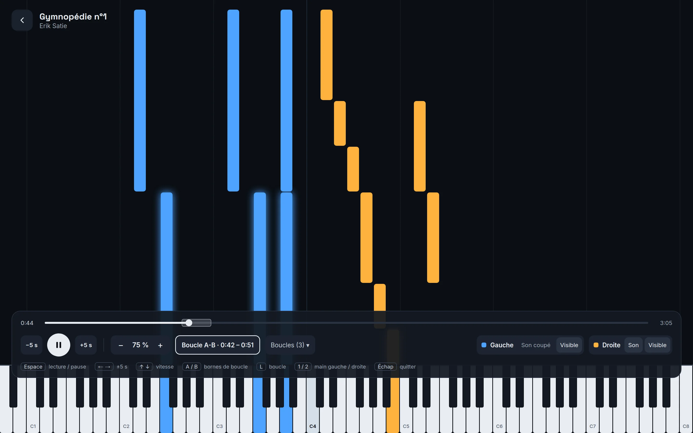
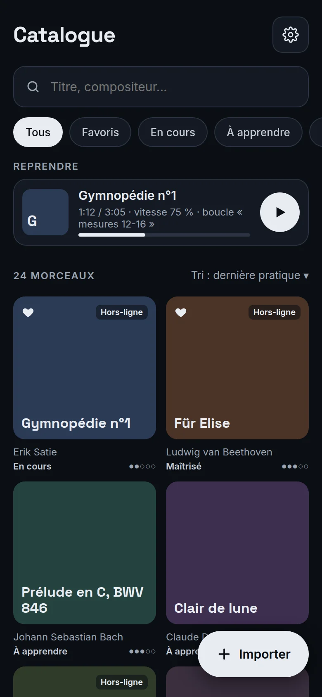
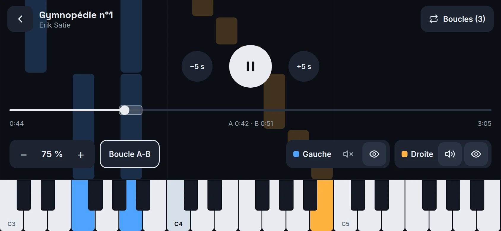
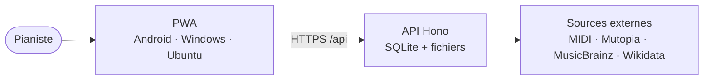

# Open Keys

**Apprendre le piano sans lire une partition.** Les notes tombent vers un clavier virtuel, tu les joues sur ton vrai piano.

Open Keys est une application *falling notes* personnelle. Elle lit des fichiers MIDI issus d'un catalogue auto-hébergé, partagé entre mobile (Android) et PC (Windows, Ubuntu).



> **Statut : fondations.** Le cadrage, l'architecture, les maquettes et l'outillage du monorepo sont en place ; le développement des fonctionnalités suit la [roadmap](docs/05-roadmap.md).

## Fonctionnalités

### MVP
- **Notes qui tombent** sur un clavier de 88 touches, avec une couleur par main : 🟦 gauche, 🟧 droite.
- **Vitesse réglable** de 25 à 100 %, sans changer la hauteur des notes.
- **Boucle A-B** sur un passage, enregistrable et nommable.
- **Une main à la fois** : son coupé et/ou main masquée, indépendamment.
- **Catalogue centralisé** : import d'un fichier MIDI ou d'une URL, écran de vérification (répartition des mains, métadonnées, couverture trouvée automatiquement).
- **Suivi de pratique** : reprise là où tu t'étais arrêté, temps de pratique, statut par morceau.
- **Hors-ligne** : les morceaux favoris et déjà ouverts restent jouables sans réseau, et la synchronisation se fait au retour du réseau.

### Ensuite
- Zoom automatique du clavier et recherche dans la bibliothèque libre [Mutopia](https://www.mutopiaproject.org/) (V1.1)
- Décompte, nom des notes, métronome (V1.2)
- **Entrée MIDI** depuis un vrai piano : vérification des notes, mode attente, score (V2)

## Aperçu

| Catalogue | Lecteur (téléphone sur trépied) |
|---|---|
|  |  |

Toutes les maquettes : [`docs/maquettes`](docs/maquettes/README.md).

## Stack

| Couche | Technologies |
|---|---|
| Front | React 19, Vite, TanStack Router et Query, Zustand, Tailwind CSS, PWA (Workbox, Dexie) |
| Rendu et audio | PixiJS (WebGL), Web Audio natif, échantillons Salamander Grand Piano |
| Back | Hono, Drizzle ORM, SQLite, sharp |
| Partagé | TypeScript strict, Zod, `@tonejs/midi` : un monorepo pnpm avec des types de bout en bout |
| Qualité | Biome, dependency-cruiser, Vitest, Playwright (Firefox et Chromium), lefthook + commitlint |
| Déploiement | docker-compose (`web` nginx + `api` Node), Dokploy sur VPS |

## Architecture



Quelques choix structurants :
- **Une seule base de code** pour les trois plateformes, sous forme de PWA. La performance n'est pas un frein : quelques centaines de rectangles par image, c'est trivial en WebGL.
- **Une seule horloge**, l'horloge audio. Le rendu se cale dessus, avec compensation de la latence de sortie. React ne pilote pas l'animation.
- **`packages/core` pur** (analyse MIDI, répartition des mains, timeline), partagé et testé côté client comme côté serveur.
- **Découpage par feature**, avec un fichier par rôle (`*.routes.ts`, `*.service.ts`, `*.queries.ts`, `*.schema.ts`…).

Le détail est dans [`docs/03-architecture`](docs/03-architecture/README.md).

## Structure

```
apps/
  web/       PWA React (catalogue, import, lecteur, pratique)
  server/    API Hono (auth, songs, imports, covers, practice…)
packages/
  core/      Analyse MIDI, répartition des mains, timeline (TypeScript pur)
  contracts/ Schémas Zod partagés front/back
docs/        Cadrage, cas d'utilisation, architecture, base de données, roadmap
```

## Documentation

| Document | Contenu |
|---|---|
| [Cadrage](docs/01-cadrage.md) | Vision, périmètre, décisions et leur raison, risques |
| [Cas d'utilisation](docs/02-use-cases.md) | Ce que fait le pianiste dans l'app |
| [Architecture](docs/03-architecture/README.md) | Contexte, stack, arborescence, lecteur, API, déploiement, sécurité, tests |
| [Base de données](docs/04-database.md) · [DBML](docs/database.dbml) | Schéma et règles de synchronisation |
| [Roadmap](docs/05-roadmap.md) | Phases et critères de fin |
| [Conventions](docs/06-conventions.md) | Règles de code |
| [Maquettes](docs/maquettes/README.md) | Écrans mobile et PC |

## Démarrage

Prérequis : [pnpm](https://pnpm.io) 12. pnpm télécharge lui-même la bonne version de Node (26 LTS).

```bash
pnpm install      # dépendances + hooks Git
pnpm dev          # web (http://localhost:5173) + API (http://localhost:3000), /api proxifié
pnpm verify       # lint, types, règles d'architecture, tests, build (comme la CI)
```

## Crédits et licences

- Code : [MIT](LICENSE).
- Échantillons de piano : [Salamander Grand Piano](https://archive.org/details/SalamanderGrandPianoV3), par Alexander Holm, sous licence CC-BY 3.0.
- Partitions MIDI libres : [Mutopia Project](https://www.mutopiaproject.org/). La licence de chaque morceau est conservée avec lui.
- Couvertures : [MusicBrainz](https://musicbrainz.org/) / [Cover Art Archive](https://coverartarchive.org/) et [Wikimedia Commons](https://commons.wikimedia.org/). L'attribution est affichée dans l'app.

Aucun fichier MIDI sous droits d'auteur n'est distribué avec ce dépôt.
