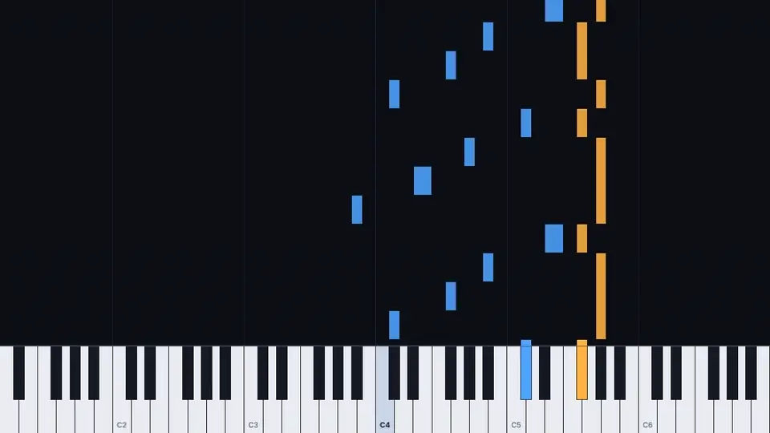
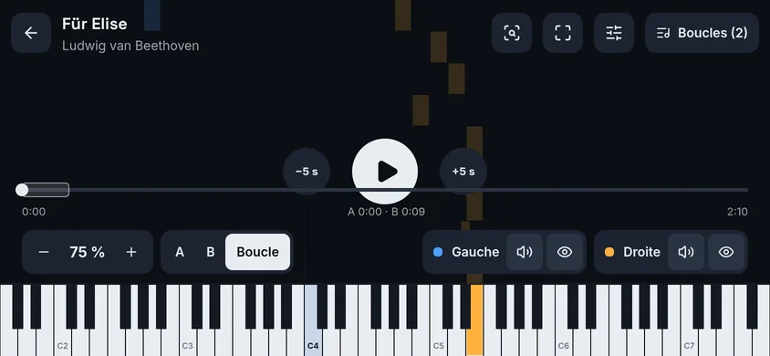
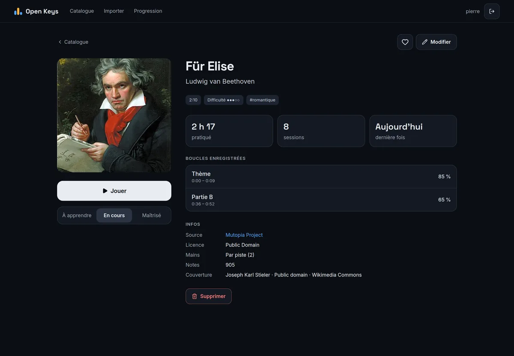
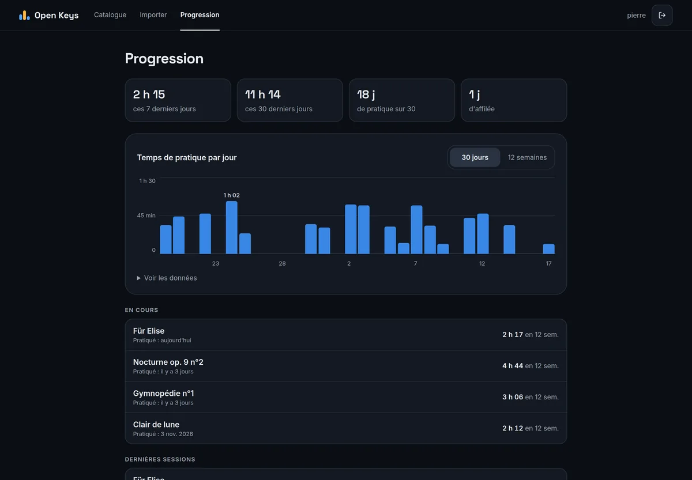
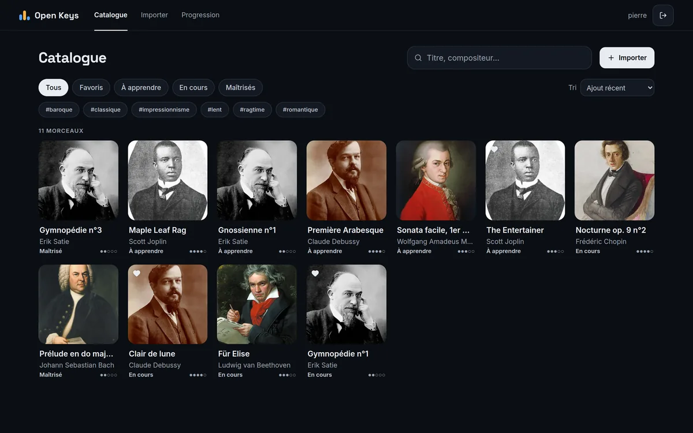
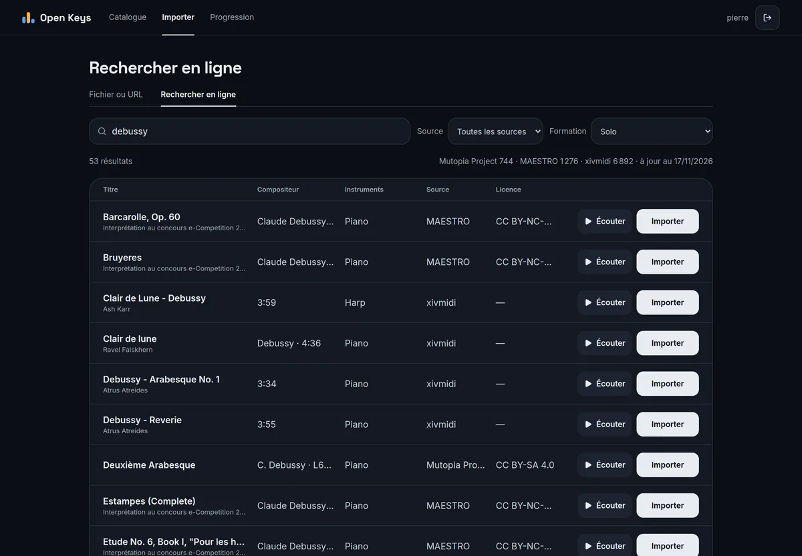
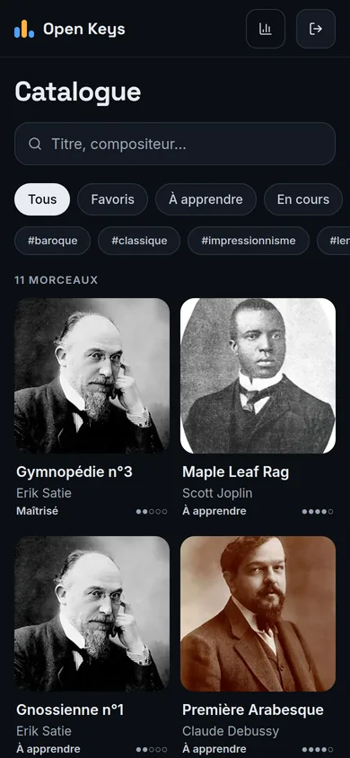
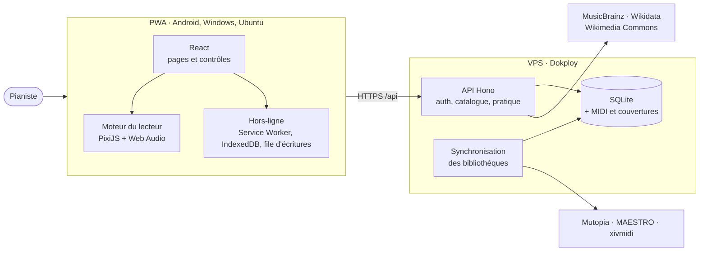

# Open Keys

[](https://github.com/Pierre-gaillard-dev/open-keys/actions/workflows/ci.yml)
[](LICENSE)

**Apprendre le piano sans lire une partition.** Les notes tombent vers un clavier virtuel, tu les joues sur ton vrai piano.

Open Keys est une application *falling notes* personnelle et auto-hébergée. Elle lit des fichiers MIDI issus d'un catalogue partagé entre mobile (Android) et PC (Windows, Ubuntu), avec une seule base de code sous forme de PWA.



> **Statut : utilisé au quotidien.** MVP terminé, ainsi que les versions 1.1 (zoom et bibliothèques en ligne), 1.2 (confort) et 1.3 (progression). Suite prévue : accompagnement à plusieurs instruments, puis entrée MIDI depuis un vrai piano ([roadmap](docs/05-roadmap.md)).

## Fonctionnalités

### Le lecteur

- **Notes qui tombent** sur un clavier de 88 touches, une couleur par main : 🟦 gauche, 🟧 droite.
- **Zoom automatique** sur la plage de notes du morceau, ou suivi glissant du passage en cours.
- **Vitesse** de 25 à 100 %, sans changer la hauteur des notes.
- **Boucle A-B** sur un passage, enregistrable et nommable.
- **Une main à la fois** : son coupé, main masquée et volume, réglables pour chaque main.
- **Décompte, métronome et nom des notes**, tous calés sur l'horloge audio.

| Sur téléphone, contrôles affichés | Fiche d'un morceau |
|---|---|
|  |  |

### Pratique et progression

- **Reprise** là où tu t'étais arrêté, avec un statut par morceau (à apprendre, en cours, maîtrisé).
- **Vitesse cible par boucle** : la meilleure vitesse est retenue après 3 passages d'affilée, et l'app propose +5 % quand le passage est acquis.
- **Tableau de bord** : temps de pratique par jour et par semaine, régularité, morceaux en cours, dernières sessions.



### Catalogue et bibliothèques en ligne

- **Import** d'un fichier MIDI ou d'une URL, avec un écran de vérification : répartition des pistes entre les mains, métadonnées, couverture trouvée automatiquement.
- **Recherche multi-sources** dans [Mutopia](https://www.mutopiaproject.org/), [MAESTRO](https://magenta.tensorflow.org/datasets/maestro) et [xivmidi](https://xivmidi.com/), soit près de 9 000 morceaux indexés par le serveur, avec **écoute avant import**. La source, la licence et le crédit de chaque fichier le suivent dans le catalogue.
- **Import depuis un enregistrement** de piano seul (mp3, opus…) : un service de transcription en tâche de fond en tire les notes, la pédale et le tempo, à vérifier comme un MIDI importé.

| Catalogue | Recherche en ligne |
|---|---|
|  |  |

### Partout, même hors-ligne

- **Installable** (PWA) sur Android, Windows et Ubuntu.
- **Hors-ligne** : les favoris et les morceaux déjà ouverts restent jouables sans réseau. La pratique enregistrée pendant ce temps est envoyée au retour du réseau.

<p align="center"></p>

## Points techniques notables

- **Une seule horloge, l'horloge audio.** Le rendu lit `AudioContext.currentTime` à chaque image et compense la latence de sortie (`outputLatency`), ce qui garde l'image et le son synchronisés, y compris en Bluetooth. Le décompte décale simplement l'ancrage de l'horloge.
- **Planification anticipée.** Les notes et les clics du métronome sont programmés sur l'horloge audio avec 150 ms d'avance, et jamais déclenchés depuis un `setTimeout`.
- **React ne pilote pas l'animation.** Le lecteur est un moteur impératif (PixiJS en WebGL, sprites réutilisés depuis un pool, aucune allocation par image). React n'affiche que les contrôles et ne se met pas à jour à chaque image.
- **Hors-ligne sans logique dupliquée.** Le cache de TanStack Query est persisté dans IndexedDB (Dexie), avec les fichiers MIDI. Les écritures passent par une file d'attente de `PUT` idempotents, fusionnés par ressource, et rejoués quand le réseau revient (sonde `/api/health`).
- **Une bibliothèque, un fournisseur.** Chaque source implémente la même interface : lister et télécharger. Le serveur synchronise un index local (pages de liste à 1 requête/s, CSV + archive ZIP extraite en flux, JSON paginé) et y cherche sur une colonne normalisée, sans accents ni ponctuation.
- **`packages/core` pur** : analyse MIDI, répartition des mains, timeline, grille des temps à partir de la carte des tempos. Sans DOM, sans Node, partagé et testé côté client comme côté serveur.
- **Règles d'architecture vérifiées** par dependency-cruiser : une feature n'en importe une autre que par son `index.ts`, le core n'importe rien d'extérieur.
- **CSP stricte en production** : pas de `unsafe-eval`, ce qui impose la variante adaptée de PixiJS et Zod en mode `jitless`.
- **Tests de bout en bout sur Chromium et Firefox** dans la CI, avec une carte son virtuelle (PulseAudio) pour que l'audio démarre vraiment.
- **Chargement à la demande** : lecteur, import, progression et moteur d'écoute sont des morceaux de bundle séparés. Le catalogue s'affiche vite, même sur mobile.

## Architecture



Le détail (contexte, moteur du lecteur, flux, API, déploiement, sécurité, tests) est dans [`docs/03-architecture`](docs/03-architecture/README.md). Chaque décision non triviale est tracée avec sa raison dans le [cadrage](docs/01-cadrage.md).

## Stack

| Couche | Technologies |
|---|---|
| Front | React 19, Vite, TanStack Router et Query, Zustand, Tailwind CSS, PWA (Workbox, Dexie) |
| Rendu et audio | PixiJS (WebGL), Web Audio natif, échantillons Salamander Grand Piano |
| Back | Hono, Drizzle ORM, SQLite, sharp, fflate |
| Partagé | TypeScript strict, Zod, `@tonejs/midi` : un monorepo pnpm avec des types de bout en bout |
| Qualité | Biome, dependency-cruiser, Vitest, Playwright (Firefox et Chromium), lefthook + commitlint |
| Déploiement | docker-compose (`web` nginx + `api` Node), Dokploy sur VPS |

## Structure

```
apps/
  web/       PWA React, découpée par feature (catalog, import, player, progress…)
  server/    API Hono, découpée par feature (auth, songs, imports, covers, sources, practice…)
  transcriber/ service Python interne : enregistrement de piano → MIDI (PyTorch, CPU)
packages/
  core/      Analyse MIDI, répartition des mains, timeline (TypeScript pur)
  contracts/ Schémas Zod partagés front/back
e2e/         Tests Playwright
docs/        Cadrage, cas d'utilisation, architecture, base de données, roadmap
```

## Documentation

| Document | Contenu |
|---|---|
| [Cadrage](docs/01-cadrage.md) | Vision, périmètre, décisions et leur raison, risques |
| [Cas d'utilisation](docs/02-use-cases.md) | Ce que fait le pianiste dans l'app |
| [Architecture](docs/03-architecture/README.md) | Contexte, stack, arborescence, lecteur, API, déploiement, sécurité, tests |
| [Base de données](docs/04-database.md) · [DBML](docs/database.dbml) | Schéma et règles de synchronisation |
| [Roadmap](docs/05-roadmap.md) | Phases et critères de fin |
| [Conventions](docs/06-conventions.md) | Règles de code |
| [Maquettes](docs/maquettes/README.md) | Écrans mobile et PC dessinés avant le développement |

## Démarrage

Prérequis : [pnpm](https://pnpm.io) 12. pnpm télécharge lui-même la bonne version de Node (26 LTS).

```bash
pnpm install      # dépendances + hooks Git
cp .env.example .env   # puis choisir ADMIN_USERNAME / ADMIN_PASSWORD (compte créé au premier démarrage)
pnpm dev          # web (http://localhost:5173) + API (http://localhost:3000), /api proxifié
pnpm verify       # lint, types, règles d'architecture, tests, build (comme la CI)
pnpm e2e          # Playwright, Chromium et Firefox (navigateurs : voir docs/03-architecture/09-tests.md)
```

Pour remplir l'index des bibliothèques en ligne, ajouter `SOURCES_SYNC=true` dans `.env`.

### Production

Deux images Docker (`web` nginx, `api` Node) et un `docker-compose.yml`, construits et déployés par Dokploy. Mise en place et variables : [déploiement](docs/03-architecture/07-deploiement.md).

```bash
# les images de production en local, sur http://localhost:8080
ADMIN_USERNAME=pierre ADMIN_PASSWORD='mot-de-passe-local' \
  docker compose -f docker-compose.yml -f docker/compose.local.yml up --build
```

## Crédits et licences

- Code : [MIT](LICENSE).
- Échantillons de piano : [Salamander Grand Piano](https://archive.org/details/SalamanderGrandPianoV3), par Alexander Holm, sous licence CC-BY 3.0.
- Transcription des enregistrements : [modèle de transcription du piano](https://zenodo.org/record/4034264) de Qiuqiang Kong et al. (ByteDance), sous licence CC-BY 4.0, avec [piano_transcription_inference](https://github.com/qiuqiangkong/piano_transcription_inference) (MIT). Tempo : [librosa](https://librosa.org/) (ISC).
- Modèle de détection au micro (labo, en essai) : [Basic Pitch](https://github.com/spotify/basic-pitch-ts), par Spotify, sous licence Apache-2.0. La licence est fournie avec le modèle dans `apps/web/public/models/basic-pitch`.
- Bibliothèques MIDI : [Mutopia Project](https://www.mutopiaproject.org/) (domaine public, Creative Commons), [MAESTRO](https://magenta.tensorflow.org/datasets/maestro) (Google Magenta, CC BY-NC-SA 4.0), [xivmidi](https://xivmidi.com/) (arrangements de la communauté). La source, la licence et le crédit de chaque morceau importé sont conservés avec lui et affichés dans l'app.
- Couvertures : [MusicBrainz](https://musicbrainz.org/) / [Cover Art Archive](https://coverartarchive.org/) et [Wikimedia Commons](https://commons.wikimedia.org/). L'attribution est affichée dans l'app.
- Captures d'écran : morceaux du domaine public importés depuis Mutopia. Portraits issus de Wikimedia Commons, dans le domaine public, sauf celui d'Erik Satie (photo restaurée par Sonia y natalia, [CC BY-SA 3.0](https://creativecommons.org/licenses/by-sa/3.0/)).

Aucun fichier MIDI n'est distribué avec ce dépôt : ils sont importés par chaque instance.
