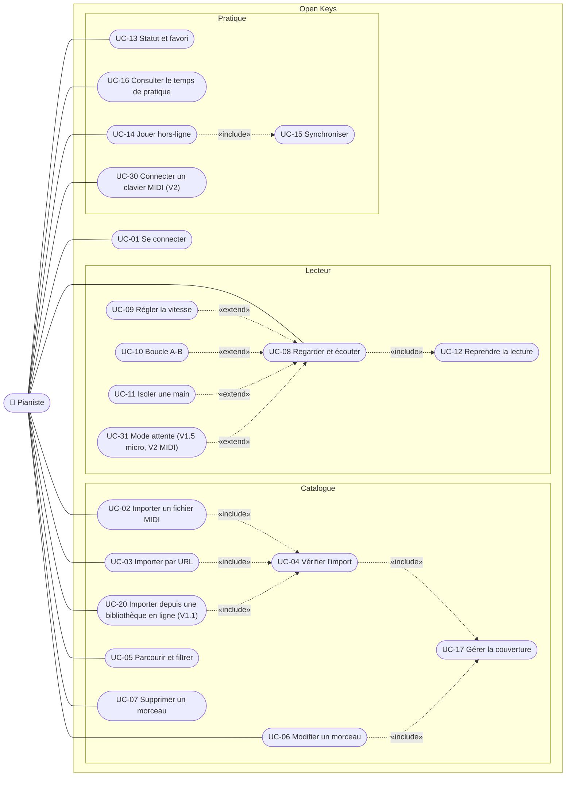

# Open Keys — Cas d'utilisation

## 1. Acteur

| Acteur | Description |
|---|---|
| **Pianiste** | Seul utilisateur, sur mobile ou sur PC |

Le backend, les sources externes (URL, bibliothèques MIDI en ligne, MusicBrainz, Wikidata) et le clavier MIDI (V2) font partie du système ou de son environnement technique, pas des acteurs. Ils apparaissent dans le **diagramme de contexte** de [`03-architecture/01-contexte.md`](./03-architecture/01-contexte.md).

## 2. Diagramme des cas d'utilisation

Notation :
- le cadre délimite le système ;
- une ligne pleine est une association avec l'acteur ;
- `«include»` signifie que le cas est toujours exécuté par le cas appelant ;
- `«extend»` signifie que le cas est optionnel à partir du cas étendu.

> UC-15 (Synchroniser) n'est jamais déclenché directement par le pianiste : le système le lance automatiquement (au retour du réseau, au démarrage, toutes les 60 s).

## 3. Liste des cas d'utilisation

| ID | Cas | Priorité |
|---|---|---|
| UC-01 | Se connecter / se déconnecter | MVP |
| UC-02 | Importer un fichier MIDI | MVP |
| UC-03 | Importer un MIDI par URL | MVP |
| UC-04 | Vérifier un import (pistes, mains, métadonnées) | MVP |
| UC-05 | Parcourir, rechercher et filtrer le catalogue | MVP |
| UC-06 | Modifier les métadonnées et l'assignation des mains (correction note par note sur PC, D28) | MVP |
| UC-07 | Supprimer un morceau | MVP |
| UC-08 | Regarder et écouter un morceau | MVP |
| UC-09 | Régler la vitesse | MVP |
| UC-10 | Créer, sauvegarder et rappeler une boucle A-B | MVP |
| UC-11 | Isoler une main (son coupé / main masquée) | MVP |
| UC-12 | Reprendre où j'en étais | MVP |
| UC-13 | Changer le statut et le favori d'un morceau | MVP |
| UC-14 | Jouer hors-ligne | MVP |
| UC-15 | Synchroniser les données de pratique | MVP |
| UC-16 | Consulter le temps de pratique d'un morceau | MVP |
| UC-17 | Gérer la couverture d'un morceau (suggestion automatique, fichier, URL) | MVP |
| UC-20 | Rechercher et importer depuis une bibliothèque en ligne (Mutopia, MAESTRO, xivmidi) | V1.1 |
| UC-21 | Zoom automatique du clavier | V1.1 |
| UC-22 | Décompte avant le départ | V1.2 |
| UC-23 | Afficher le nom des notes (C, D, E… ou Do, Ré, Mi…) | V1.2 |
| UC-24 | Métronome | V1.2 |
| UC-25 | Volume par main | V1.2 |
| UC-26 | Vitesse cible par boucle | V1.3 |
| UC-27 | Tableau de bord de pratique | V1.3 |
| UC-34 | Inviter quelqu'un (lien à usage unique) | V1.4 |
| UC-35 | Rejoindre l'app ou choisir un nouveau mot de passe depuis un lien | V1.4 |
| UC-36 | Changer son mot de passe | V1.4 |
| UC-37 | Gérer les comptes (désactiver, mot de passe oublié) | V1.4 |
| UC-38 | Importer depuis un enregistrement de piano (mp3, opus…) et jouer avec le vrai son | V1.6 |
| UC-30 | Connecter un clavier MIDI | V2 |
| UC-31 | Mode attente (la lecture attend la bonne note) | V1.5 (micro), V2 (MIDI) |
| UC-32 | Score et précision de session | V1.5 (micro) |
| UC-33 | Mettre en pause avec une touche du piano | V2 |

## 4. Cas détaillés

### UC-01 — Se connecter
- **Précondition** : un compte existe, créé au premier démarrage du serveur à partir des variables d'environnement.
- **Scénario** :
  1. Le pianiste saisit son identifiant et son mot de passe.
  2. Le serveur vérifie le hash (argon2id) et crée une session.
  3. Le serveur renvoie un cookie `httpOnly`, `Secure`, `SameSite=Lax`, valable 90 jours.
- **Alternatives** :
  - Identifiants invalides : l'erreur est générique et les tentatives sont limitées (rate-limit).
  - Hors-ligne et session déjà ouverte : l'app s'ouvre avec les données en cache.
- **Postcondition** : toutes les requêtes à l'API sont authentifiées.

### UC-02 / UC-03 — Importer un MIDI (fichier ou URL)
- **Précondition** : être connecté et en ligne.
- **Scénario** :
  1. Le pianiste choisit un fichier `.mid`/`.midi` ou colle une URL.
  2. Le serveur télécharge le fichier si besoin, puis vérifie : taille ≤ 2 Mo, en-tête `MThd`, analyse réussie.
  3. Le serveur calcule le SHA-256. **Si le fichier existe déjà**, il propose d'ouvrir le morceau existant.
  4. Le serveur analyse le fichier (`packages/core`) : pistes, canaux, nombre de notes, plage de notes, durée, métadonnées internes (nom de piste, copyright).
  5. Le serveur crée un morceau à l'état `draft` avec une **proposition d'assignation des mains** : seules les pistes de piano sont jouées quand le fichier en contient (arrangement de groupe), les autres instruments sont ignorés.
  6. Redirection vers UC-04.
- **Alternatives** :
  - Fichier invalide ou trop gros : erreur explicite, rien n'est conservé.
  - URL inaccessible, mauvais type de contenu ou délai dépassé (10 s) : erreur explicite.
  - L'import par URL ne doit pas pouvoir viser le réseau interne (protection SSRF) : seulement http/https, et les IP privées sont refusées.

### UC-04 — Vérifier un import
- **Scénario** :
  1. L'écran affiche les pistes (nom, canal, nombre de notes, plage) et la répartition proposée. Par défaut, le mode est **note par note** (D28) : l'algorithme donne chaque note à une main, les pistes servent seulement à choisir ce qui est joué ou ignoré. Un piano roll montre le résultat.
  2. Le pianiste peut :
     - jouer ou ignorer une piste ;
     - **sur PC**, corriger la main de notes choisies dans le piano roll (rectangle de sélection à la souris, Maj pour ajouter), puis « Recalculer automatiquement » pour revenir au résultat de l'algorithme ;
     - passer en mode **par piste** (une main par piste) ou **par hauteur** (note de séparation, C4 par défaut) ;
     - **écouter un aperçu** (le lecteur en version réduite) avec les couleurs de main.
  3. Le pianiste complète les métadonnées : titre (pré-rempli depuis le nom stocké dans le MIDI, sauf s'il ne nomme qu'une piste ou un instrument comme « Piste 1 » ou « Grand Piano 1 », sinon depuis le nom de fichier), compositeur, difficulté, tags, source, licence.
  4. **Couverture** (UC-17) : l'app propose des candidats trouvés automatiquement à partir du titre et du compositeur. Le pianiste en choisit un, en fournit un autre (fichier ou URL) ou n'en met aucun.
  5. Il valide : le morceau passe à l'état `ready`.
- **Alternatives** :
  - Abandon : le brouillon est purgé automatiquement après 24 h.
- **Règles de la proposition automatique** :
  - au moins deux pistes avec des notes : la piste dont la hauteur moyenne est la plus haute va à droite, la plus basse à gauche, les autres sont ignorées si elles sont percussives (canal 10) ;
  - une seule piste : découpage par hauteur à C4 (MIDI 60).

### UC-05 — Parcourir le catalogue
- Recherche texte (titre, compositeur), filtres (tags, statut, favori, difficulté) et tri (titre, date d'ajout, dernière pratique).
- Hors-ligne : seuls les morceaux en cache sont listés, et un badge l'indique.

### UC-06 / UC-07 — Modifier / supprimer un morceau
- La modification reprend l'écran UC-04 sur un morceau `ready`.
- La suppression demande une confirmation. C'est une suppression logique (`deleted_at`) : le fichier est purgé par une tâche différée et les données de pratique liées sont conservées 30 jours.

### UC-17 — Gérer la couverture d'un morceau
- **Format** : WebP **720×720** (carré, comme une pochette d'album), recadré au centre, qualité 80.
- **Suggestions automatiques**, lancées en parallèle avec un timeout de 5 s par fournisseur :
  1. **MusicBrainz + Cover Art Archive** (gratuit, sans clé) : recherche d'un enregistrement ou d'un album à partir du titre et de l'artiste, puis récupération de la pochette. Pertinent pour la pop, les musiques de film et de jeu vidéo.
  2. **Wikidata / Wikimedia Commons** : **portrait du compositeur** (propriété P18). C'est le bon choix pour le classique, où il n'existe pas « un » album de référence. Le crédit et la licence sont enregistrés dans `cover_credit`.
- **Choix manuel** : upload d'une image ou URL. Ces images sont converties de la même façon.
- **Sans couverture** : couverture générée par le client (dégradé calculé à partir de l'id, avec titre et compositeur). Aucun fichier n'est stocké.
- Modifiable plus tard depuis la fiche du morceau (UC-06).
- Le fichier MIDI ne contient jamais d'image : la couverture vient toujours d'une source externe ou de l'utilisateur.

### UC-08 — Regarder et écouter
- **Précondition** : le morceau est en cache local, ou on est en ligne.
- **Scénario** :
  1. L'app charge le MIDI (depuis le cache, sinon depuis le réseau), l'analyse et applique l'assignation des mains.
  2. Elle restaure les réglages du morceau (UC-12).
  3. Elle passe en plein écran, en paysage, et active le Wake Lock.
  4. Lecture : les notes tombent, les touches s'allument, le son est synchronisé.
  5. Toucher l'écran affiche les contrôles, qui se masquent au bout de 3 s.
  6. Sur PC, les raccourcis : `Espace` lecture/pause, `←`/`→` reculer/avancer de 5 s, `↑`/`↓` vitesse ±5 %, `A`/`B` bornes de la boucle, `L` activer/désactiver la boucle, `1`/`2` main gauche/droite.
- **Postcondition** : une session de pratique est enregistrée (UC-15) dès qu'il y a au moins 10 s de lecture effective.

### UC-09 — Régler la vitesse
- De 25 à 100 %, par pas de 5 %. La hauteur des notes ne change pas.
- La vitesse de chute des notes à l'écran reste constante en pixels par seconde réelle : seul le défilement ralentit.

### UC-10 — Boucle A-B
- Pose des bornes A et B avec les raccourcis ou en sélectionnant une zone sur la barre de progression. Les bornes s'alignent sur la note la plus proche.
- Sauvegarde avec un nom optionnel. Liste des boucles du morceau, rappel en un geste.
- La boucle est stockée en **temps de partition** (ms à 100 %).

### UC-11 — Isoler une main
- Pour chaque main, deux réglages indépendants : **son** (activé/coupé) et **affichage** (visible/masqué).

### UC-12 — Reprendre où j'en étais
- Sont mémorisés par morceau et par utilisateur : position, vitesse, réglages des mains, dernière boucle active.
- Écriture locale immédiate (avec un délai de 2 s), puis synchronisation (UC-15).

### UC-13 — Statut et favori
- Statut : `to_learn` (à apprendre), `learning` (en cours) ou `mastered` (maîtrisé). Favori : oui/non.
- Un favori est **mis en cache hors-ligne automatiquement** (le MIDI est téléchargé).

### UC-14 / UC-15 — Hors-ligne et synchronisation
- Le Service Worker met en cache le shell de l'app et les échantillons de piano.
- Les MIDI sont stockés dans IndexedDB dès qu'on les ouvre ou qu'on les met en favori.
- Toute écriture de données de pratique (réglages, boucles, sessions, statut) passe par une **file d'attente locale** (outbox) :
  - écriture locale d'abord, puis tentative d'envoi ;
  - chaque requête est **idempotente** (`PUT` avec un identifiant ULID généré par le client) ;
  - nouvel essai au retour du réseau, au démarrage et toutes les 60 s ;
  - en cas de conflit, la dernière écriture l'emporte, sur la base de `updated_at`.
- Le catalogue (morceaux, tags) n'est modifiable qu'en ligne.

### UC-20 — Rechercher et importer depuis une bibliothèque en ligne (V1.1)
- Depuis l'import, onglet (PC) ou entrée (téléphone) « Rechercher en ligne ».
- **Une seule recherche** sur toutes les bibliothèques, ou sur une seule : Mutopia Project (classique, domaine public et Creative Commons), MAESTRO (interprétations de concours, CC BY-NC-SA) et xivmidi (arrangements communautaires : pop, jeux vidéo, anime…).
- Par titre, compositeur ou artiste, opus, arrangeur, sans tenir compte des accents, de la casse ni de la ponctuation. Par défaut, les morceaux **solo** ; « Tout » ajoute les ensembles, le chant…
- **Écouter** un morceau avant de l'importer (piano de l'app, mains proposées par l'import).
- **Importer** passe par l'écran de vérification, avec titre, compositeur, licence et **crédit** pré-remplis. La fiche du morceau affiche ensuite la bibliothèque (lien vers la page d'origine) et le crédit. Un morceau déjà importé affiche « Dans le catalogue ».
- Les index sont copiés sur le serveur et mis à jour régulièrement : la recherche ne dépend pas de la disponibilité des sites.

### UC-22 à UC-25 — Confort (V1.2)
- **Décompte** (UC-22) : une mesure de clics avant de jouer et à chaque retour en début de boucle, avec un grand chiffre au centre de l'écran. Les notes descendent déjà pendant le décompte.
- **Nom des notes** (UC-23) : sur les notes qui tombent, sur les touches, ou les deux. La notation est un réglage du compte, dans « Mon compte » : anglaise (C, D, E…) ou française (Do, Ré, Mi…), avec des dièses. Elle s'applique partout où une note est nommée : lecteur, import, labo micro. En français, l'octave suit la convention française : le do du milieu est Do3, alors qu'il est C4 en anglais.
- **Métronome** (UC-24) : un clic par temps, calé sur la mesure du fichier, temps fort accentué.
- **Volume par main** (UC-25) : de 0 à 100 %, mémorisé avec les autres réglages des mains du morceau.
- Décompte, métronome et nom des notes sont des réglages de l'appareil, valables pour tous les morceaux. Ils s'activent depuis le bouton « Réglages » du lecteur, ou au clavier (`C`, `M`, `N`).

### UC-26 / UC-27 — Progression (V1.3)
- **Vitesse cible par boucle** (UC-26) : réglée dans le panneau des boucles. La boucle garde sa meilleure vitesse (jouée 3 tours de suite), et après 5 tours l'app propose « Passer à +5 % ? » jusqu'à la cible.
- **Tableau de bord** (UC-27), page « Progression » :
  - temps de pratique des 7 et 30 derniers jours, jours pratiqués, série de jours d'affilée ;
  - histogramme par jour (30 jours) ou par semaine (12 semaines), avec une infobulle au survol et un tableau des données ;
  - morceaux en cours avec leur temps de pratique ;
  - dernières sessions (morceau, date, vitesses, durée).
- Disponible hors-ligne avec les dernières données chargées.

### UC-16 — Temps de pratique
- Sur la fiche d'un morceau : temps total, nombre de sessions, date de la dernière pratique.

### UC-34 à UC-37 — Multi-utilisateur (V1.4, D29)
- **Inviter** (UC-34, administrateur) : « Mon compte » → « Inviter quelqu'un » crée un lien à usage unique, valable 7 jours, affiché une seule fois, à copier ou partager.
- **Rejoindre** (UC-35) : le lien ouvre une page sans connexion. La personne choisit son identifiant (unique, quelle que soit la casse) et son mot de passe (10 caractères minimum), puis arrive connectée sur le catalogue, comme **membre**.
- **Mot de passe oublié** : l'administrateur crée depuis la liste des comptes un lien du même type pour ce compte. Le nouveau mot de passe déconnecte tous ses appareils.
- **Changer son mot de passe** (UC-36) : depuis « Mon compte », avec le mot de passe actuel. Les autres appareils sont déconnectés, celui-ci reste connecté.
- **Gérer les comptes** (UC-37, administrateur) : liste des comptes, désactivation et réactivation. Un compte désactivé est déconnecté partout et ne peut plus se connecter. Ses imports restent au catalogue, ses données personnelles sont gardées.
- **Catalogue commun** : tout le monde voit, joue et importe tous les morceaux. Seuls celui qui a importé un morceau et l'administrateur peuvent le modifier ou le supprimer.
- **Données personnelles** (bibliothèque, favoris, boucles, progression) propres à chaque compte, y compris sur un appareil partagé : à la connexion d'un autre compte, le cache de l'appareil est vidé, et les écritures en attente du précédent ne partent qu'avec sa propre session.

### UC-31 — Mode attente (V1.5, au micro)
- **Activation** : dans Réglages, section « Jouer au piano », « Écouter mon piano » avec la façon de jouer « Attendre chaque accord ». Le micro s'ouvre ; le navigateur demande l'autorisation la première fois.
- **Je joue** : main gauche, main droite ou les deux. Ces mains sont coupées dans la lecture : c'est toi qui les joues, et le micro ne doit pas entendre l'app les jouer. L'autre main continue d'être jouée par l'app.
- **Arrêt** : à chaque accord de ces mains, les notes s'arrêtent sur la ligne du clavier et un badge affiche les notes qui manquent (« À toi : Do4 · Mi4 »). La lecture repart dès que tout l'accord est entendu. Les notes frappées un peu avant que l'accord arrive (0,4 s) comptent.
- Pause, boucle, retour en arrière et fin du morceau fonctionnent comme d'habitude : l'accord attendu devient le premier à partir de la nouvelle position.
- Si le micro est refusé ou absent, un message le dit et la lecture reste normale.

### UC-32 — Jouer en rythme et score (V1.5, au micro)
- **En rythme** : même section, façon de jouer « En rythme ». La lecture ne s'arrête pas : chaque accord des mains travaillées devient **vert** s'il est entendu entre 0,4 s avant et 0,35 s après son passage, **rouge** sinon. La marge après tient compte du délai du micro.
- **Score en direct** : un badge affiche le nombre d'accords joués et la part de bons accords.
  - En rythme : « 12 accords · 92 % à temps ».
  - En mode attente : « 12 accords · 80 % sans attendre », c'est-à-dire joués avant que la lecture n'ait à s'arrêter.
- **Enregistrement** : la session garde son mode, sa précision et son nombre d'accords. Changer de mode ou de mains commence une nouvelle session. La page Progression les affiche (« Au piano, en rythme · 92 % »).
- **Notes en trop** : non mesurées au micro. La détection libre se trompe trop pour dire qu'une note jouée n'était pas attendue. Elles le seront en MIDI (V2).

### UC-38 — Importer depuis un enregistrement (V1.6, D34)
- **Où** : Importer → onglet « Enregistrement » ; sur téléphone, l'entrée « Depuis un enregistrement ».
- **Envoi** : un enregistrement de **piano seul** (reprise, tutoriel) en mp3, opus, m4a, wav… de 15 minutes et 40 Mo au plus. Le navigateur mesure sa durée pour l'estimation.
- **Suivi** : la liste des transcriptions dit où en est chacune :
  - « en attente », avec le nombre d'enregistrements avant ;
  - « en cours », avec les minutes restantes estimées ;
  - « transcrit » ;
  - « échec », avec la raison : fichier illisible, aucune note de piano, trop long, ou autre.
  
  On peut quitter la page : la transcription continue sur le serveur.
- **Résultat** : un brouillon, avec les notes, la pédale et une grille de temps sur le tempo détecté, ce qui fait suivre la musique au métronome et au décompte. On le vérifie comme un MIDI importé (mains, métadonnées, pochette), via le lien « Vérifier ». Son crédit indique la transcription automatique.
- **Depuis une adresse** (D35) : si le serveur a des sources audio autorisées, on colle l'URL d'un enregistrement de l'app qui récupère la musique. Cette app peut aussi lancer elle-même la transcription par l'API d'intégration.
- **Enregistrement gardé** (D35) : le morceau garde son URL, ou le fichier envoyé. Une transcription qui échoue supprime le fichier envoyé. Au plus 3 enregistrements en attente par personne.
- **Jouer avec le vrai son** (D35) : dans le lecteur, « Son : Piano / Enregistrement ». L'enregistrement d'origine est calé sur les notes : il suit la pause, les sauts, les boucles et le mode attente, et au ralenti il garde le ton. Il n'est téléchargé qu'au premier choix. Il n'est pas proposé pendant « Jouer au piano », car le micro l'entendrait.

### UC-30, UC-33 — V2 (aperçu)
- La couche `InputSource` (créée en V1.5) reçoit les notes d'un clavier MIDI (Web MIDI, plugin natif Capacitor, ou clavier à l'écran pour les tests). Le mode attente s'en sert sans changement.
- Score : précision des notes et du rythme, enregistrée dans `practice_sessions`.
