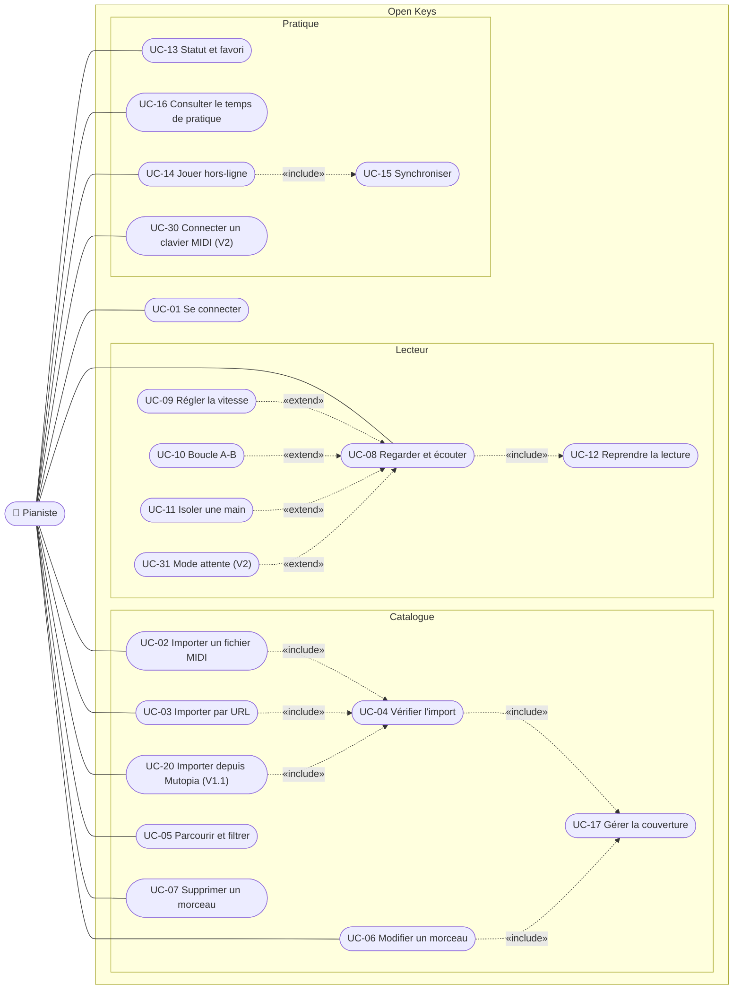

# Open Keys — Cas d'utilisation

## 1. Acteur

| Acteur | Description |
|---|---|
| **Pianiste** | Seul utilisateur, sur mobile ou sur PC |

Le backend, les sources externes (URL, Mutopia, MusicBrainz, Wikidata) et le clavier MIDI (V2) font partie du système ou de son environnement technique, pas des acteurs. Ils apparaissent dans le **diagramme de contexte** de [`03-architecture/01-contexte.md`](./03-architecture/01-contexte.md).

## 2. Diagramme des cas d'utilisation

Notation :
- le cadre délimite le système ;
- une ligne pleine est une association avec l'acteur ;
- `«include»` signifie que le cas est toujours exécuté par le cas appelant ;
- `«extend»` signifie que le cas est optionnel à partir du cas étendu.

> UC-15 (Synchroniser) n'est jamais déclenché directement par le pianiste : le système le lance automatiquement (au retour du réseau, au démarrage, toutes les 60 s).

## 3. Liste des cas d'utilisation

| ID | Cas | Priorité |
|---|---|---|
| UC-01 | Se connecter / se déconnecter | MVP |
| UC-02 | Importer un fichier MIDI | MVP |
| UC-03 | Importer un MIDI par URL | MVP |
| UC-04 | Vérifier un import (pistes, mains, métadonnées) | MVP |
| UC-05 | Parcourir, rechercher et filtrer le catalogue | MVP |
| UC-06 | Modifier les métadonnées et l'assignation des mains | MVP |
| UC-07 | Supprimer un morceau | MVP |
| UC-08 | Regarder et écouter un morceau | MVP |
| UC-09 | Régler la vitesse | MVP |
| UC-10 | Créer, sauvegarder et rappeler une boucle A-B | MVP |
| UC-11 | Isoler une main (son coupé / main masquée) | MVP |
| UC-12 | Reprendre où j'en étais | MVP |
| UC-13 | Changer le statut et le favori d'un morceau | MVP |
| UC-14 | Jouer hors-ligne | MVP |
| UC-15 | Synchroniser les données de pratique | MVP |
| UC-16 | Consulter le temps de pratique d'un morceau | MVP |
| UC-17 | Gérer la couverture d'un morceau (suggestion automatique, fichier, URL) | MVP |
| UC-20 | Rechercher et importer depuis Mutopia | V1.1 |
| UC-21 | Zoom automatique du clavier | V1.1 |
| UC-22 | Décompte avant le départ | V1.2 |
| UC-23 | Afficher le nom des notes (C, D, E…) | V1.2 |
| UC-24 | Métronome | V1.2 |
| UC-25 | Volume par main | V1.2 |
| UC-26 | Vitesse cible par boucle | V1.3 |
| UC-27 | Tableau de bord de pratique | V1.3 |
| UC-30 | Connecter un clavier MIDI | V2 |
| UC-31 | Mode attente (la lecture attend la bonne note) | V2 |
| UC-32 | Score et précision de session | V2 |
| UC-33 | Mettre en pause avec une touche du piano | V2 |

## 4. Cas détaillés

### UC-01 — Se connecter
- **Précondition** : un compte existe, créé au premier démarrage du serveur à partir des variables d'environnement.
- **Scénario** :
  1. Le pianiste saisit son identifiant et son mot de passe.
  2. Le serveur vérifie le hash (argon2id) et crée une session.
  3. Le serveur renvoie un cookie `httpOnly`, `Secure`, `SameSite=Lax`, valable 90 jours.
- **Alternatives** :
  - Identifiants invalides : l'erreur est générique et les tentatives sont limitées (rate-limit).
  - Hors-ligne et session déjà ouverte : l'app s'ouvre avec les données en cache.
- **Postcondition** : toutes les requêtes à l'API sont authentifiées.

### UC-02 / UC-03 — Importer un MIDI (fichier ou URL)
- **Précondition** : être connecté et en ligne.
- **Scénario** :
  1. Le pianiste choisit un fichier `.mid`/`.midi` ou colle une URL.
  2. Le serveur télécharge le fichier si besoin, puis vérifie : taille ≤ 2 Mo, en-tête `MThd`, analyse réussie.
  3. Le serveur calcule le SHA-256. **Si le fichier existe déjà**, il propose d'ouvrir le morceau existant.
  4. Le serveur analyse le fichier (`packages/core`) : pistes, canaux, nombre de notes, plage de notes, durée, métadonnées internes (nom de piste, copyright).
  5. Le serveur crée un morceau à l'état `draft` avec une **proposition d'assignation des mains**.
  6. Redirection vers UC-04.
- **Alternatives** :
  - Fichier invalide ou trop gros : erreur explicite, rien n'est conservé.
  - URL inaccessible, mauvais type de contenu ou délai dépassé (10 s) : erreur explicite.
  - L'import par URL ne doit pas pouvoir viser le réseau interne (protection SSRF) : seulement http/https, et les IP privées sont refusées.

### UC-04 — Vérifier un import
- **Scénario** :
  1. L'écran affiche les pistes (nom, canal, nombre de notes, plage) avec l'assignation proposée : `left`, `right` ou `ignore`.
  2. Le pianiste peut :
     - changer l'assignation d'une piste ;
     - passer en mode **découpage par hauteur** (une seule piste) et régler la note de séparation, C4 par défaut ;
     - **écouter un aperçu** (le lecteur en version réduite) avec les couleurs de main.
  3. Le pianiste complète les métadonnées : titre (pré-rempli depuis le MIDI ou le nom de fichier), compositeur, difficulté, tags, source, licence.
  4. **Couverture** (UC-17) : l'app propose des candidats trouvés automatiquement à partir du titre et du compositeur. Le pianiste en choisit un, en fournit un autre (fichier ou URL) ou n'en met aucun.
  5. Il valide : le morceau passe à l'état `ready`.
- **Alternatives** :
  - Abandon : le brouillon est purgé automatiquement après 24 h.
- **Règles de la proposition automatique** :
  - au moins deux pistes avec des notes : la piste dont la hauteur moyenne est la plus haute va à droite, la plus basse à gauche, les autres sont ignorées si elles sont percussives (canal 10) ;
  - une seule piste : découpage par hauteur à C4 (MIDI 60).

### UC-05 — Parcourir le catalogue
- Recherche texte (titre, compositeur), filtres (tags, statut, favori, difficulté) et tri (titre, date d'ajout, dernière pratique).
- Hors-ligne : seuls les morceaux en cache sont listés, et un badge l'indique.

### UC-06 / UC-07 — Modifier / supprimer un morceau
- La modification reprend l'écran UC-04 sur un morceau `ready`.
- La suppression demande une confirmation. C'est une suppression logique (`deleted_at`) : le fichier est purgé par une tâche différée et les données de pratique liées sont conservées 30 jours.

### UC-17 — Gérer la couverture d'un morceau
- **Format** : WebP **720×720** (carré, comme une pochette d'album), recadré au centre, qualité 80.
- **Suggestions automatiques**, lancées en parallèle avec un timeout de 5 s par fournisseur :
  1. **MusicBrainz + Cover Art Archive** (gratuit, sans clé) : recherche d'un enregistrement ou d'un album à partir du titre et de l'artiste, puis récupération de la pochette. Pertinent pour la pop, les musiques de film et de jeu vidéo.
  2. **Wikidata / Wikimedia Commons** : **portrait du compositeur** (propriété P18). C'est le bon choix pour le classique, où il n'existe pas « un » album de référence. Le crédit et la licence sont enregistrés dans `cover_credit`.
- **Choix manuel** : upload d'une image ou URL. Ces images sont converties de la même façon.
- **Sans couverture** : couverture générée par le client (dégradé calculé à partir de l'id, avec titre et compositeur). Aucun fichier n'est stocké.
- Modifiable plus tard depuis la fiche du morceau (UC-06).
- Le fichier MIDI ne contient jamais d'image : la couverture vient toujours d'une source externe ou de l'utilisateur.

### UC-08 — Regarder et écouter
- **Précondition** : le morceau est en cache local, ou on est en ligne.
- **Scénario** :
  1. L'app charge le MIDI (depuis le cache, sinon depuis le réseau), l'analyse et applique l'assignation des mains.
  2. Elle restaure les réglages du morceau (UC-12).
  3. Elle passe en plein écran, en paysage, et active le Wake Lock.
  4. Lecture : les notes tombent, les touches s'allument, le son est synchronisé.
  5. Toucher l'écran affiche les contrôles, qui se masquent au bout de 3 s.
  6. Sur PC, les raccourcis : `Espace` lecture/pause, `←`/`→` reculer/avancer de 5 s, `↑`/`↓` vitesse ±5 %, `A`/`B` bornes de la boucle, `L` activer/désactiver la boucle, `1`/`2` main gauche/droite.
- **Postcondition** : une session de pratique est enregistrée (UC-15) dès qu'il y a au moins 10 s de lecture effective.

### UC-09 — Régler la vitesse
- De 25 à 100 %, par pas de 5 %. La hauteur des notes ne change pas.
- La vitesse de chute des notes à l'écran reste constante en pixels par seconde réelle : seul le défilement ralentit.

### UC-10 — Boucle A-B
- Pose des bornes A et B avec les raccourcis ou en sélectionnant une zone sur la barre de progression. Les bornes s'alignent sur la note la plus proche.
- Sauvegarde avec un nom optionnel. Liste des boucles du morceau, rappel en un geste.
- La boucle est stockée en **temps de partition** (ms à 100 %).

### UC-11 — Isoler une main
- Pour chaque main, deux réglages indépendants : **son** (activé/coupé) et **affichage** (visible/masqué).

### UC-12 — Reprendre où j'en étais
- Sont mémorisés par morceau et par utilisateur : position, vitesse, réglages des mains, dernière boucle active.
- Écriture locale immédiate (avec un délai de 2 s), puis synchronisation (UC-15).

### UC-13 — Statut et favori
- Statut : `to_learn` (à apprendre), `learning` (en cours) ou `mastered` (maîtrisé). Favori : oui/non.
- Un favori est **mis en cache hors-ligne automatiquement** (le MIDI est téléchargé).

### UC-14 / UC-15 — Hors-ligne et synchronisation
- Le Service Worker met en cache le shell de l'app et les échantillons de piano.
- Les MIDI sont stockés dans IndexedDB dès qu'on les ouvre ou qu'on les met en favori.
- Toute écriture de données de pratique (réglages, boucles, sessions, statut) passe par une **file d'attente locale** (outbox) :
  - écriture locale d'abord, puis tentative d'envoi ;
  - chaque requête est **idempotente** (`PUT` avec un identifiant ULID généré par le client) ;
  - nouvel essai au retour du réseau, au démarrage et toutes les 60 s ;
  - en cas de conflit, la dernière écriture l'emporte, sur la base de `updated_at`.
- Le catalogue (morceaux, tags) n'est modifiable qu'en ligne.

### UC-20 — Rechercher et importer depuis Mutopia (V1.1)
- Depuis l'import, onglet (PC) ou entrée (téléphone) « Rechercher en ligne ».
- Recherche par titre, compositeur ou opus, sans tenir compte des accents ni de la casse. Par défaut, les pièces pour clavier seul ; « Avec piano » ajoute le chant, les duos…
- **Écouter** un morceau avant de l'importer (piano de l'app, mains proposées par l'import).
- **Importer** passe par l'écran de vérification, avec titre, compositeur et licence pré-remplis. Un morceau déjà importé affiche « Dans le catalogue ».
- L'index est copié sur le serveur et mis à jour chaque semaine : la recherche ne dépend pas de la disponibilité de Mutopia.

### UC-16 — Temps de pratique
- Sur la fiche d'un morceau : temps total, nombre de sessions, date de la dernière pratique.

### UC-30 à UC-33 — V2 (aperçu)
- La couche `InputSource` reçoit des événements `noteOn`/`noteOff` (Web MIDI, plugin natif Capacitor, ou clavier à l'écran pour les tests).
- Mode attente : la lecture se fige avant chaque groupe de notes attendu jusqu'à ce qu'il soit joué (avec une tolérance d'accord).
- Score : précision des notes et du rythme, enregistrée dans `practice_sessions`.
