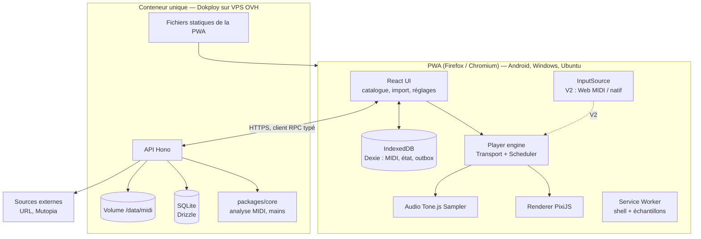
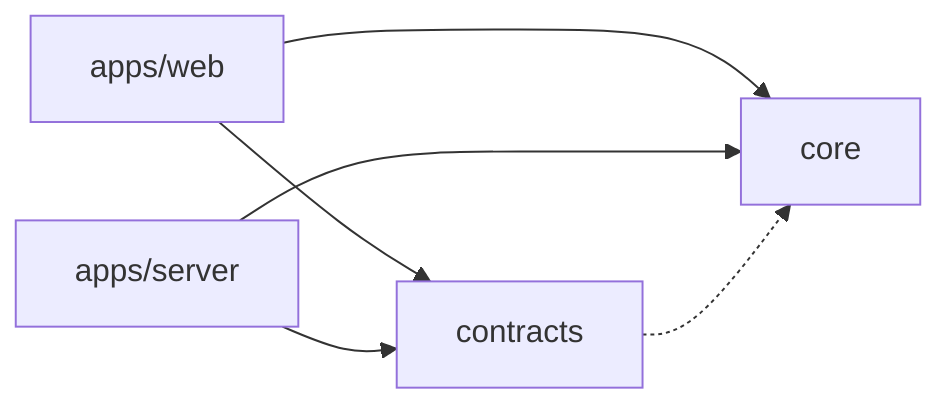
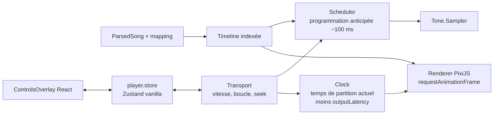
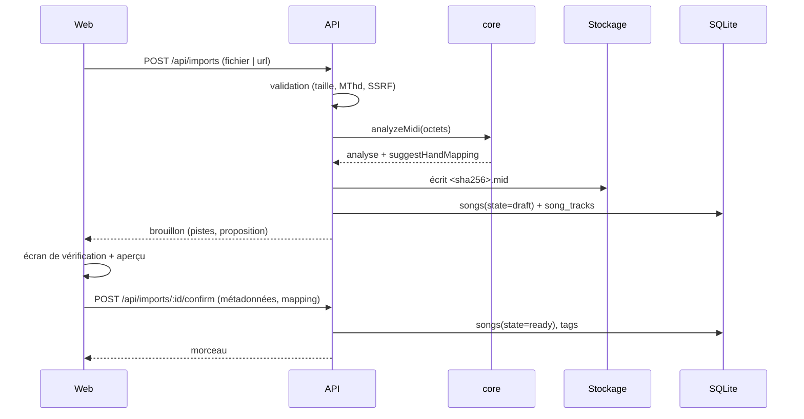
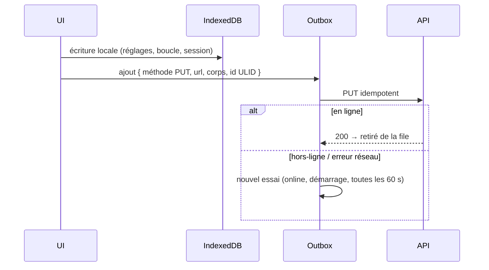

# Open Keys — Architecture

## 1. Vue d'ensemble



## 2. Stack

| Couche | Choix | Rôle |
|---|---|---|
| Monorepo | **pnpm workspaces** + Turborepo (facultatif) | Applications et packages partagés |
| Langage | **TypeScript strict** partout | Typage de bout en bout |
| Front | **React 19 + Vite** | Interface (pas de rendu serveur : c'est une PWA) |
| Routage | **TanStack Router** | Routes typées |
| État serveur | **TanStack Query** | Cache et invalidation des données de l'API |
| État du lecteur | **Zustand** (store vanilla) | Lu par le renderer **hors du cycle de rendu React** |
| Rendu | **PixiJS v8** (WebGL) | Notes qui tombent et clavier |
| Audio | **Tone.js** (`Sampler`, `Transport`) | Lecture, tempo, boucles |
| Analyse MIDI | **@tonejs/midi** | Utilisé côté client et serveur via `packages/core` |
| Hors-ligne | **vite-plugin-pwa** (Workbox) + **Dexie** (IndexedDB) | Cache et file d'attente de synchronisation |
| Style | **Tailwind CSS** + composants maison | Thème sombre, cibles tactiles larges |
| API | **Hono** + `@hono/zod-validator` + client RPC `hc` | API typée, sans génération de code |
| Validation | **Zod** (schémas dans `packages/contracts`) | Schémas partagés entre le front et le back |
| Base de données | **SQLite** (`better-sqlite3`) + **Drizzle ORM / drizzle-kit** | Schéma, migrations, requêtes typées |
| Authentification | Sessions en base, cookie `httpOnly`, hash **argon2id** | Un seul utilisateur, prêt pour plusieurs |
| Qualité | **Biome** (lint et formatage), `tsc --noEmit`, **Vitest**, **Playwright** (e2e) | CI stricte |
| Déploiement | Dockerfile multi-stage, Dokploy (Traefik, HTTPS) | Un seul conteneur, volume `/data` |

## 3. Arborescence

```
open-keys/
├── apps/
│   ├── web/                                  # PWA React
│   │   ├── public/
│   │   │   ├── samples/salamander/           # échantillons OGG + LICENSE (CC-BY)
│   │   │   └── icons/
│   │   ├── src/
│   │   │   ├── app/                          # assemblage de l'application
│   │   │   │   ├── providers.tsx             # QueryClient, thème…
│   │   │   │   ├── router.tsx
│   │   │   │   └── routes/                   # fichiers de route fins → pages des features
│   │   │   ├── features/
│   │   │   │   ├── auth/
│   │   │   │   │   ├── api/
│   │   │   │   │   │   ├── auth.api.ts       # appels du client RPC
│   │   │   │   │   │   └── auth.queries.ts   # hooks TanStack Query
│   │   │   │   │   ├── components/
│   │   │   │   │   ├── pages/LoginPage.tsx
│   │   │   │   │   └── index.ts              # API publique de la feature
│   │   │   │   ├── catalog/
│   │   │   │   │   ├── api/                  # catalog.api.ts, catalog.queries.ts
│   │   │   │   │   ├── components/           # SongCard, SongFilters, StatusBadge…
│   │   │   │   │   ├── hooks/                # useSongFilters.ts
│   │   │   │   │   ├── pages/                # CatalogPage, SongDetailPage
│   │   │   │   │   └── index.ts
│   │   │   │   ├── import/
│   │   │   │   │   ├── api/
│   │   │   │   │   ├── components/           # TrackMappingTable, SplitPitchPicker, MetadataForm
│   │   │   │   │   ├── schemas/              # import-form.schema.ts (zod du formulaire)
│   │   │   │   │   ├── pages/                # ImportPage, ImportReviewPage
│   │   │   │   │   └── index.ts
│   │   │   │   ├── player/
│   │   │   │   │   ├── engine/
│   │   │   │   │   │   ├── transport.ts      # horloge, vitesse, boucle (Tone.Transport)
│   │   │   │   │   │   ├── scheduler.ts      # programmation des notes vers le sampler
│   │   │   │   │   │   ├── clock.ts          # temps de partition ↔ temps audio, compensation de latence
│   │   │   │   │   │   └── player-engine.ts  # façade : load / play / pause / seek / setTempo
│   │   │   │   │   ├── audio/
│   │   │   │   │   │   ├── piano-sampler.ts
│   │   │   │   │   │   └── sustain.ts        # gestion du CC64
│   │   │   │   │   ├── renderer/
│   │   │   │   │   │   ├── falling-notes.renderer.ts
│   │   │   │   │   │   ├── keyboard.renderer.ts
│   │   │   │   │   │   ├── layout.ts         # géométrie des 88 touches, plage visible
│   │   │   │   │   │   └── theme.ts          # couleurs des mains, repères de C
│   │   │   │   │   ├── input/                # V2 : InputSource, WebMidiInput, ScreenKeyboardInput
│   │   │   │   │   ├── stores/player.store.ts
│   │   │   │   │   ├── components/           # PlayerCanvas, ControlsOverlay, LoopBar, SpeedControl
│   │   │   │   │   ├── hooks/                # useWakeLock, useFullscreen, usePlayerShortcuts
│   │   │   │   │   ├── pages/PlayerPage.tsx
│   │   │   │   │   └── index.ts
│   │   │   │   ├── practice/
│   │   │   │   │   ├── api/                  # practice.api.ts, practice.queries.ts
│   │   │   │   │   ├── session-tracker.ts    # calcul du temps de lecture effective
│   │   │   │   │   ├── components/           # LoopList, PracticeStats, StatusSelect
│   │   │   │   │   └── index.ts
│   │   │   │   └── settings/
│   │   │   └── shared/
│   │   │       ├── api/client.ts             # instance hc<AppType>
│   │   │       ├── offline/
│   │   │       │   ├── db.ts                 # schéma Dexie
│   │   │       │   ├── midi-cache.ts
│   │   │       │   └── outbox.ts             # file d'attente + rejeu idempotent
│   │   │       ├── ui/                       # Button, Dialog, Slider… (sans logique métier)
│   │   │       └── lib/                      # utilitaires génériques
│   │   ├── index.html
│   │   └── vite.config.ts
│   │
│   └── server/                               # API Hono
│       ├── src/
│       │   ├── index.ts                      # démarrage (serve)
│       │   ├── app.ts                        # composition des routes, export AppType
│       │   ├── config/env.ts                 # variables d'environnement validées par zod
│       │   ├── db/
│       │   │   ├── client.ts                 # instance Drizzle + pragmas SQLite
│       │   │   ├── schema.ts                 # ré-exporte les *.schema.ts des features
│       │   │   ├── seed.ts                   # création de l'utilisateur initial
│       │   │   └── migrations/               # générées par drizzle-kit
│       │   ├── features/
│       │   │   ├── auth/
│       │   │   │   ├── auth.routes.ts        # handlers HTTP, aussi fins que possible
│       │   │   │   ├── auth.service.ts       # logique métier
│       │   │   │   ├── auth.queries.ts       # accès à la base uniquement
│       │   │   │   ├── auth.schema.ts        # tables Drizzle (users, sessions)
│       │   │   │   ├── auth.middleware.ts
│       │   │   │   └── auth.service.test.ts
│       │   │   ├── songs/                    # songs, song_tracks
│       │   │   ├── tags/
│       │   │   ├── imports/                  # upload, URL, protection SSRF, purge des brouillons
│       │   │   │   ├── imports.routes.ts
│       │   │   │   ├── imports.service.ts
│       │   │   │   ├── url-fetcher.ts
│       │   │   │   └── …
│       │   │   ├── library/                  # user_songs (statut, favori, réglages)
│       │   │   ├── practice/                 # loops, practice_sessions
│       │   │   └── mutopia/                  # V1.1 : index local + synchronisation
│       │   └── shared/
│       │       ├── storage/file-storage.ts   # écriture/lecture /data/midi/<sha256>.mid
│       │       ├── http/errors.ts            # erreurs métier → codes HTTP
│       │       ├── http/middlewares.ts       # logs, rate-limit, sécurité
│       │       └── jobs/scheduler.ts         # tâches différées (purge)
│       ├── drizzle.config.ts
│       └── vitest.config.ts
│
├── packages/
│   ├── core/                                 # TypeScript pur, sans DOM ni Node : testable partout
│   │   └── src/
│   │       ├── midi/
│   │       │   ├── parse-midi.ts             # octets → ParsedSong
│   │       │   ├── analyze-midi.ts           # pistes, plages, durée, statistiques
│   │       │   └── midi.types.ts
│   │       ├── hands/
│   │       │   ├── suggest-hand-mapping.ts   # heuristiques
│   │       │   ├── apply-hand-mapping.ts     # ParsedSong + mapping → notes avec leur main
│   │       │   └── hands.types.ts
│   │       ├── timeline/                     # index temporel, recherche des notes dans une fenêtre
│   │       ├── music/                        # noms de notes, pitch ↔ touche, détection des touches noires
│   │       └── index.ts
│   ├── contracts/                            # schémas zod des échanges avec l'API (entrées/sorties)
│   │   └── src/{songs,imports,practice,library,auth}.contract.ts
│   └── config/                               # tsconfig de base, preset Biome
│
├── docs/
├── docker/
│   └── Dockerfile
├── docker-compose.yml                        # local / auto-hébergement
├── biome.json
├── pnpm-workspace.yaml
├── package.json
├── LICENSE                                   # MIT
└── README.md
```

### Dépendances autorisées entre modules



- `packages/core` ne dépend de rien d'interne.
- Une feature n'importe une autre feature **que via son `index.ts`**. On n'importe jamais directement un fichier interne d'une autre feature.
- `shared/` n'importe jamais `features/`.

## 4. Le moteur du lecteur

Principe : **une seule horloge**, l'horloge audio. React ne pilote pas l'animation.



- **Temps de partition** : référence unique, en ms à 100 %. Positions, boucles et timeline l'utilisent.
- **Vitesse** : appliquée sur le Transport. La hauteur des notes est conservée, puisque le son est recalculé à partir du MIDI.
- **Synchro** : à chaque image, le renderer lit `clock.now()` = temps du Transport − latence de sortie, puis dessine les notes de la fenêtre `[now, now + horizon]` grâce à une recherche dichotomique dans la timeline.
- **Performance** : objets graphiques réutilisés (pool de `Graphics`/`Sprite`), aucune allocation dans la boucle de rendu, aucun rendu React pendant la lecture.
- **Couche d'entrée (V2)** : l'interface `InputSource { onNoteOn, onNoteOff, dispose }`. Le moteur ne connaît pas l'origine des événements.

## 5. Flux principaux

### Import



### Synchronisation hors-ligne



## 6. API (MVP)

Toutes les routes sont sous `/api` et exigent une session, sauf `POST /auth/login`. Entrées et sorties sont validées par les schémas de `packages/contracts`.

| Méthode | Route | Rôle |
|---|---|---|
| POST | `/auth/login` | Connexion |
| POST | `/auth/logout` | Déconnexion |
| GET | `/auth/me` | Utilisateur courant |
| GET | `/songs` | Liste (`q`, `tags`, `status`, `favorite`, `difficulty`, `sort`) |
| GET | `/songs/:id` | Détail, avec les pistes et l'assignation des mains |
| GET | `/songs/:id/midi` | Fichier MIDI (ETag = sha256, `Cache-Control: immutable`) |
| PATCH | `/songs/:id` | Métadonnées et assignation des mains |
| DELETE | `/songs/:id` | Suppression logique |
| POST | `/imports` | Upload (multipart) ou `{ url }` → brouillon |
| POST | `/imports/:id/confirm` | Validation du brouillon |
| GET | `/tags` | Tags existants |
| GET | `/library` | Les entrées `user_songs` de l'utilisateur |
| PUT | `/library/:songId` | Statut, favori, réglages (dernière écriture l'emporte) |
| GET | `/songs/:id/loops` | Boucles de l'utilisateur pour ce morceau |
| PUT | `/loops/:id` | Créer ou modifier une boucle (identifiant ULID fourni par le client) |
| DELETE | `/loops/:id` | Suppression logique |
| PUT | `/practice-sessions/:id` | Enregistrer une session (idempotent) |
| GET | `/songs/:id/practice-stats` | Temps total, nombre de sessions, dernière pratique |
| GET | `/health` | Sonde Dokploy |

## 7. Déploiement

- **Dockerfile multi-stage** :
  1. installation pnpm ;
  2. build de `web` (fichiers statiques) et de `server` (build tsup/esbuild) ;
  3. image finale `node:22-slim` qui contient le serveur et `web/dist`, servi par Hono (`serveStatic`, repli SPA sur `index.html`).
- **Volume** `/data` : `open-keys.db` (SQLite en mode WAL) et `midi/`.
- **Migrations** Drizzle appliquées au démarrage. L'utilisateur initial est créé à partir de `ADMIN_USERNAME`/`ADMIN_PASSWORD` s'il n'existe pas.
- **Variables d'environnement** : `DATA_DIR`, `SESSION_SECRET`, `ADMIN_USERNAME`, `ADMIN_PASSWORD`, `PUBLIC_URL`, `MAX_MIDI_SIZE`.
- **Sauvegarde** : sauvegarde planifiée de `/data` par Dokploy, ou cron `sqlite3 .backup` + rsync.

## 8. Sécurité

- Cookies `httpOnly`, `Secure`, `SameSite=Lax`, avec vérification de l'en-tête `Origin` sur les requêtes qui modifient des données.
- Hash des mots de passe en argon2id, rate-limit sur `/auth/login`.
- Import par URL : seulement http/https, résolution DNS puis refus des IP privées et locales, délai maximal de 10 s, 2 Mo maximum, 3 redirections au plus.
- Fichiers stockés sous le nom de leur hash : aucun chemin fourni par l'utilisateur n'est utilisé.
- En-têtes de sécurité : CSP stricte, `X-Content-Type-Options`.

## 9. Stratégie de test

| Niveau | Cible | Outil |
|---|---|---|
| Unitaires | `packages/core` (analyse, heuristiques des mains, timeline) : **priorité n°1** | Vitest + MIDI de test du domaine public |
| Unitaires | services du serveur, `clock`/`transport` du lecteur | Vitest |
| Intégration | routes de l'API sur une base SQLite en mémoire | Vitest + `app.request()` de Hono |
| E2E | import → lecture → boucle → hors-ligne | Playwright (Firefox **et** Chromium) |
| Manuel | synchro son/image, fluidité | Pixel 10, checklist dans la roadmap |
