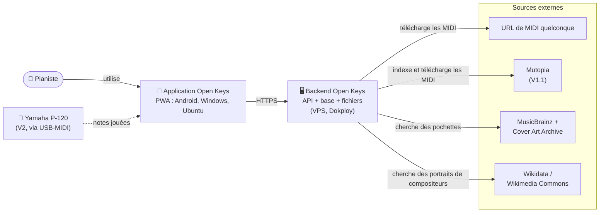
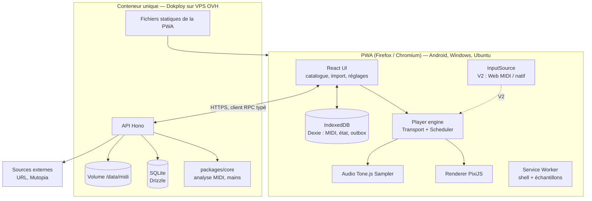

# Open Keys — Architecture : Contexte et vue d'ensemble

[← Sommaire](./README.md)

## Contexte

Qui parle à qui, sans détail interne.

Seul le backend contacte les sources externes. L'application ne parle qu'au backend : pas de problème de CORS, et la protection SSRF, les limites et le cache sont gérés à un seul endroit.

## Vue d'ensemble

