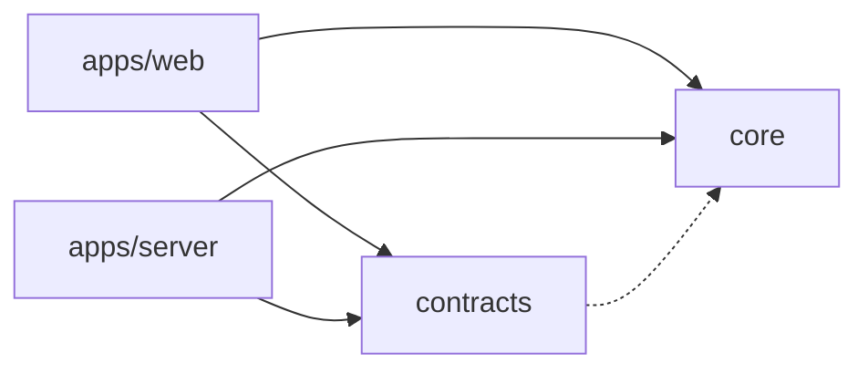

# Open Keys — Architecture : Arborescence

[← Sommaire](./README.md)

```
open-keys/
├── apps/
│   ├── web/                                  # PWA React
│   │   ├── public/
│   │   │   ├── samples/salamander/           # échantillons OGG + LICENSE (CC-BY)
│   │   │   └── icons/
│   │   ├── src/
│   │   │   ├── app/                          # assemblage de l'application
│   │   │   │   ├── providers.tsx             # QueryClient, thème…
│   │   │   │   ├── router.tsx
│   │   │   │   └── routes/                   # fichiers de route fins → pages des features
│   │   │   ├── features/
│   │   │   │   ├── auth/
│   │   │   │   │   ├── api/
│   │   │   │   │   │   ├── auth.api.ts       # appels du client RPC
│   │   │   │   │   │   └── auth.queries.ts   # hooks TanStack Query
│   │   │   │   │   ├── components/
│   │   │   │   │   ├── pages/LoginPage.tsx
│   │   │   │   │   └── index.ts              # API publique de la feature
│   │   │   │   ├── catalog/
│   │   │   │   │   ├── api/                  # catalog.api.ts, catalog.queries.ts
│   │   │   │   │   ├── components/           # SongCard, SongFilters, StatusBadge…
│   │   │   │   │   ├── hooks/                # useSongFilters.ts
│   │   │   │   │   ├── pages/                # CatalogPage, SongDetailPage
│   │   │   │   │   └── index.ts
│   │   │   │   ├── import/
│   │   │   │   │   ├── api/
│   │   │   │   │   ├── components/           # TrackMappingTable, SplitPitchPicker, MetadataForm
│   │   │   │   │   ├── schemas/              # import-form.schema.ts (zod du formulaire)
│   │   │   │   │   ├── pages/                # ImportPage, ImportReviewPage
│   │   │   │   │   └── index.ts
│   │   │   │   ├── player/
│   │   │   │   │   ├── engine/
│   │   │   │   │   │   ├── transport.ts      # horloge, vitesse, boucle (Tone.Transport)
│   │   │   │   │   │   ├── scheduler.ts      # programmation des notes vers le sampler
│   │   │   │   │   │   ├── clock.ts          # temps de partition ↔ temps audio, compensation de latence
│   │   │   │   │   │   └── player-engine.ts  # façade : load / play / pause / seek / setTempo
│   │   │   │   │   ├── audio/
│   │   │   │   │   │   ├── piano-sampler.ts
│   │   │   │   │   │   └── sustain.ts        # gestion du CC64
│   │   │   │   │   ├── renderer/
│   │   │   │   │   │   ├── falling-notes.renderer.ts
│   │   │   │   │   │   ├── keyboard.renderer.ts
│   │   │   │   │   │   ├── layout.ts         # géométrie des 88 touches, plage visible
│   │   │   │   │   │   └── theme.ts          # couleurs des mains, repères de C
│   │   │   │   │   ├── input/                # V2 : InputSource, WebMidiInput, ScreenKeyboardInput
│   │   │   │   │   ├── stores/player.store.ts
│   │   │   │   │   ├── components/           # PlayerCanvas, ControlsOverlay, LoopBar, SpeedControl
│   │   │   │   │   ├── hooks/                # useWakeLock, useFullscreen, usePlayerShortcuts
│   │   │   │   │   ├── pages/PlayerPage.tsx
│   │   │   │   │   └── index.ts
│   │   │   │   ├── practice/
│   │   │   │   │   ├── api/                  # practice.api.ts, practice.queries.ts
│   │   │   │   │   ├── session-tracker.ts    # calcul du temps de lecture effective
│   │   │   │   │   ├── components/           # LoopList, PracticeStats, StatusSelect
│   │   │   │   │   └── index.ts
│   │   │   │   └── settings/
│   │   │   └── shared/
│   │   │       ├── api/client.ts             # instance hc<AppType>
│   │   │       ├── offline/
│   │   │       │   ├── db.ts                 # schéma Dexie
│   │   │       │   ├── midi-cache.ts
│   │   │       │   └── outbox.ts             # file d'attente + rejeu idempotent
│   │   │       ├── ui/                       # Button, Dialog, Slider… (sans logique métier)
│   │   │       └── lib/                      # utilitaires génériques
│   │   ├── index.html
│   │   └── vite.config.ts
│   │
│   └── server/                               # API Hono
│       ├── src/
│       │   ├── index.ts                      # démarrage (serve)
│       │   ├── app.ts                        # composition des routes, export AppType
│       │   ├── config/env.ts                 # variables d'environnement validées par zod
│       │   ├── db/
│       │   │   ├── client.ts                 # instance Drizzle + pragmas SQLite
│       │   │   ├── schema.ts                 # ré-exporte les *.schema.ts des features
│       │   │   ├── seed.ts                   # création de l'utilisateur initial
│       │   │   └── migrations/               # générées par drizzle-kit
│       │   ├── features/
│       │   │   ├── auth/
│       │   │   │   ├── auth.routes.ts        # handlers HTTP, aussi fins que possible
│       │   │   │   ├── auth.service.ts       # logique métier
│       │   │   │   ├── auth.queries.ts       # accès à la base uniquement
│       │   │   │   ├── auth.schema.ts        # tables Drizzle (users, sessions)
│       │   │   │   ├── auth.middleware.ts
│       │   │   │   └── auth.service.test.ts
│       │   │   ├── songs/                    # songs, song_tracks
│       │   │   ├── tags/
│       │   │   ├── imports/                  # upload, URL, protection SSRF, purge des brouillons
│       │   │   │   ├── imports.routes.ts
│       │   │   │   ├── imports.service.ts
│       │   │   │   ├── url-fetcher.ts
│       │   │   │   └── …
│       │   │   ├── covers/                   # couvertures des morceaux
│       │   │   │   ├── covers.routes.ts
│       │   │   │   ├── covers.service.ts     # suggestions, choix, remplacement
│       │   │   │   ├── image-processor.ts    # sharp : validation, recadrage, WebP 720×720
│       │   │   │   └── providers/
│       │   │   │       ├── cover-provider.types.ts       # interface CoverProvider
│       │   │   │       ├── musicbrainz.provider.ts       # MusicBrainz + Cover Art Archive
│       │   │   │       └── wikidata.provider.ts          # portrait du compositeur
│       │   │   ├── library/                  # user_songs (statut, favori, réglages)
│       │   │   ├── practice/                 # loops, practice_sessions
│       │   │   └── mutopia/                  # V1.1 : index local + synchronisation
│       │   └── shared/
│       │       ├── http/safe-fetch.ts        # fetch sortant : SSRF, timeout, limite de taille (imports + couvertures)
│       │       ├── storage/file-storage.ts   # /data/midi/<sha256>.mid, /data/covers/<sha256>.webp
│       │       ├── http/errors.ts            # erreurs métier → codes HTTP
│       │       ├── http/middlewares.ts       # logs, rate-limit, sécurité
│       │       └── jobs/scheduler.ts         # tâches différées (purge)
│       ├── drizzle.config.ts
│       └── vitest.config.ts
│
├── packages/
│   ├── core/                                 # TypeScript pur, sans DOM ni Node : testable partout
│   │   └── src/
│   │       ├── midi/
│   │       │   ├── parse-midi.ts             # octets → ParsedSong
│   │       │   ├── analyze-midi.ts           # pistes, plages, durée, statistiques
│   │       │   └── midi.types.ts
│   │       ├── hands/
│   │       │   ├── suggest-hand-mapping.ts   # heuristiques
│   │       │   ├── apply-hand-mapping.ts     # ParsedSong + mapping → notes avec leur main
│   │       │   └── hands.types.ts
│   │       ├── timeline/                     # index temporel, recherche des notes dans une fenêtre
│   │       ├── music/                        # noms de notes, pitch ↔ touche, détection des touches noires
│   │       └── index.ts
│   ├── contracts/                            # schémas zod des échanges avec l'API (entrées/sorties)
│   │   └── src/{songs,imports,practice,library,auth}.contract.ts
│   └── config/                               # tsconfig de base, preset Biome
│
├── docs/
├── docker/
│   ├── web.Dockerfile                        # build Vite → nginx:alpine
│   ├── api.Dockerfile                        # build tsup → node:22-slim
│   ├── nginx.conf                            # repli SPA, cache, compression
│   └── Caddyfile                             # reverse proxy local (rôle de Traefik)
├── docker-compose.yml                        # web + api (+ proxy en local)
├── .env.example
├── biome.json
├── pnpm-workspace.yaml
├── package.json
├── LICENSE                                   # MIT
└── README.md
```

## Dépendances autorisées entre modules



- `packages/core` ne dépend de rien d'interne.
- Une feature n'importe une autre feature **que via son `index.ts`**. On n'importe jamais directement un fichier interne d'une autre feature.
- `shared/` n'importe jamais `features/`.
