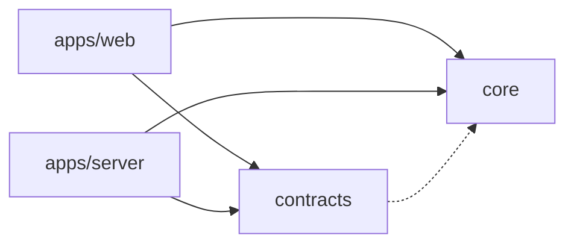

# Open Keys — Architecture : Arborescence

[← Sommaire](./README.md)

```
open-keys/
├── apps/
│   ├── web/                                  # PWA React
│   │   ├── public/
│   │   │   ├── samples/salamander/           # échantillons OGG + LICENSE (CC-BY)
│   │   │   └── icons/
│   │   ├── src/
│   │   │   ├── main.tsx                      # point d'entrée : CSS global + createApp()
│   │   │   ├── app/                          # assemblage de l'application
│   │   │   │   ├── create-app.ts             # QueryClient + routeur ; un 401 n'importe où renvoie à la connexion
│   │   │   │   ├── query-client.ts           # pas de nouvel essai sur 4xx, gestion du 401
│   │   │   │   ├── router.tsx                # routes typées (TanStack Router), garde d'authentification
│   │   │   │   ├── layout/AppShell.tsx       # barre du haut (pas de barre latérale) + page courante
│   │   │   │   ├── global.css                # Tailwind v4 : jetons de couleurs et polices
│   │   │   │   └── app-flows.test.tsx        # parcours complets : app réelle + API simulée
│   │   │   ├── features/
│   │   │   │   ├── auth/
│   │   │   │   │   ├── api/
│   │   │   │   │   │   ├── auth.api.ts       # appels HTTP (client fetch typé par les contrats)
│   │   │   │   │   │   └── auth.queries.ts   # hooks TanStack Query
│   │   │   │   │   ├── pages/LoginPage.tsx
│   │   │   │   │   └── index.ts              # API publique de la feature
│   │   │   │   ├── catalog/
│   │   │   │   │   ├── api/                  # catalog.api.ts, catalog.queries.ts (clés « songs »)
│   │   │   │   │   ├── catalog-search.ts     # état du catalogue dans l'URL → paramètres d'API
│   │   │   │   │   ├── components/           # SongCard, SongCover (couverture générée), CatalogFilters
│   │   │   │   │   ├── pages/                # CatalogPage, SongDetailPage
│   │   │   │   │   └── index.ts
│   │   │   │   ├── import/
│   │   │   │   │   ├── api/                  # import.api.ts, import.queries.ts (import, validation, couvertures)
│   │   │   │   │   ├── song-form.ts          # modèle du formulaire, validé par les contrats
│   │   │   │   │   ├── components/           # SongEditor, TrackHandsEditor, CoverPicker, TagsInput
│   │   │   │   │   ├── pages/                # ImportPage, ImportReviewPage, SongEditPage (même éditeur)
│   │   │   │   │   └── index.ts
│   │   │   │   ├── library/                  # statut et favori (mise à jour optimiste)
│   │   │   │   ├── player/
│   │   │   │   │   ├── engine/
│   │   │   │   │   │   ├── transport.ts      # lecture, pause, seek, vitesse, boucle (déplace l'ancre de l'horloge)
│   │   │   │   │   │   ├── scheduler.ts      # programmation des notes vers le sampler
│   │   │   │   │   │   ├── clock.ts          # temps de partition ↔ temps audio, compensation de latence
│   │   │   │   │   │   └── player-engine.ts  # façade : load / play / pause / seek / setTempo
│   │   │   │   │   ├── audio/
│   │   │   │   │   │   ├── piano-sampler.ts
│   │   │   │   │   │   └── sustain.ts        # gestion du CC64
│   │   │   │   │   ├── renderer/
│   │   │   │   │   │   ├── falling-notes.renderer.ts
│   │   │   │   │   │   ├── keyboard.renderer.ts
│   │   │   │   │   │   ├── layout.ts         # géométrie des 88 touches, plage visible
│   │   │   │   │   │   └── theme.ts          # couleurs des mains, repères de C
│   │   │   │   │   ├── input/                # V2 : InputSource, WebMidiInput, ScreenKeyboardInput
│   │   │   │   │   ├── stores/player.store.ts
│   │   │   │   │   ├── components/           # PlayerCanvas, ControlsOverlay, LoopBar, SpeedControl
│   │   │   │   │   ├── hooks/                # useWakeLock, useFullscreen, usePlayerShortcuts
│   │   │   │   │   ├── pages/PlayerPage.tsx
│   │   │   │   │   └── index.ts
│   │   │   │   ├── practice/
│   │   │   │   │   ├── api/                  # practice.api.ts, practice.queries.ts
│   │   │   │   │   ├── session-tracker.ts    # (phase 4) calcul du temps de lecture effective
│   │   │   │   │   ├── components/           # PracticeSummary (statistiques, boucles)
│   │   │   │   │   └── index.ts
│   │   │   │   └── settings/
│   │   │   └── shared/
│   │   │       ├── api/http-client.ts        # apiRequest() : /api, réponses validées par zod, ApiError
│   │   │       ├── offline/
│   │   │       │   ├── db.ts                 # schéma Dexie
│   │   │       │   ├── midi-cache.ts
│   │   │       │   └── outbox.ts             # file d'attente + rejeu idempotent
│   │   │       ├── ui/                       # Button, Chip, SegmentedControl, TextField… (sans logique métier)
│   │   │       ├── lib/                      # cx (tailwind-merge), format, use-debounced-value
│   │   │       └── test/                     # (dans src/test) fake-api, fixtures, render-app
│   │   ├── index.html
│   │   └── vite.config.ts
│   │
│   └── server/                               # API Hono
│       ├── src/
│       │   ├── index.ts                      # démarrage : env → stockage → base + migrations → compte initial → serveur → maintenance
│       │   ├── services.ts                   # racine de composition : instancie tous les services (dépendances injectées)
│       │   ├── app.ts                        # middlewares, préfixes protégés, montage des routes, export AppType
│       │   ├── config/env.ts                 # variables d'environnement validées par zod
│       │   ├── db/
│       │   │   ├── client.ts                 # better-sqlite3 + Drizzle, pragmas, migrations au démarrage, types Executor/Transaction
│       │   │   ├── schema.ts                 # ré-exporte les *.schema.ts des features (drizzle-kit, client typé)
│       │   │   └── migrations/               # générées par drizzle-kit, copiées dans dist/ au build
│       │   ├── features/
│       │   │   ├── health/                   # GET /api/health
│       │   │   ├── auth/
│       │   │   │   ├── auth.routes.ts        # handlers HTTP, aussi fins que possible
│       │   │   │   ├── auth.service.ts       # connexion, sessions glissantes, compte initial
│       │   │   │   ├── auth.queries.ts       # accès à la base uniquement
│       │   │   │   ├── auth.schema.ts        # tables Drizzle (users, auth_sessions)
│       │   │   │   ├── auth.middleware.ts    # requireAuth → c.var.user
│       │   │   │   ├── password-hasher.ts    # argon2id (node:crypto), format PHC
│       │   │   │   ├── login-rate-limiter.ts # 5 échecs / 15 min par (client, identifiant)
│       │   │   │   ├── session-cookie.ts
│       │   │   │   └── *.test.ts
│       │   │   ├── songs/                    # catalogue : songs, song_tracks ; songs.mapper.ts (lignes → contrats)
│       │   │   ├── tags/                     # tags, song_tags
│       │   │   ├── imports/                  # fichier, URL, déduplication, brouillon, validation
│       │   │   ├── covers/
│       │   │   │   ├── covers.routes.ts      # monté sous /songs : /songs/:id/cover…
│       │   │   │   ├── covers.service.ts     # suggestions (cache 1 h), choix, upload, URL
│       │   │   │   ├── image-processor.ts    # sharp : validation, recadrage, WebP 720×720
│       │   │   │   └── providers/            # MusicBrainz + Cover Art Archive, Wikidata + Commons
│       │   │   ├── library/                  # user_songs (statut, favori, réglages), dernière écriture l'emporte
│       │   │   ├── practice/                 # loops, practice_sessions, statistiques
│       │   │   ├── maintenance/              # purges : brouillons, morceaux supprimés, sessions, tags, fichiers orphelins
│       │   │   └── mutopia/                  # V1.1 : index local + synchronisation
│       │   ├── shared/
│       │   │   ├── http/                     # app-env, errors, error-handler, validation, request-logger,
│       │   │   │                             # client-ip, safe-fetch (SSRF : IP vérifiée à la connexion)
│       │   │   ├── logger/                   # logger JSON à niveaux
│       │   │   ├── storage/file-storage.ts   # /data/midi/<sha256>.mid, /data/covers/<sha256>.webp (écriture atomique)
│       │   │   ├── jobs/periodic-job.ts      # tâche périodique sans chevauchement
│       │   │   └── runtime.ts                # Clock et générateur d'ULID injectables
│       │   └── test/                         # banc de test : serveur complet en mémoire, fixtures, logger mémoire
│       ├── scripts/generate-dbml.ts          # docs/database.dbml généré depuis le schéma Drizzle
│       ├── drizzle.config.ts
│       ├── tsdown.config.ts
│       └── vitest.config.ts
│
├── packages/
│   ├── core/                                 # TypeScript pur, sans DOM ni Node : testable partout
│   │   └── src/
│   │       ├── midi/
│   │       │   ├── analyze-midi.ts           # pistes, plages, durée, titre ; InvalidMidiError
│   │       │   ├── tonejs-midi.ts            # interop UMD/ESM de @tonejs/midi (Node et bundlers)
│   │       │   ├── midi-fixtures.ts          # MIDI de test construits en mémoire (export "@open-keys/core/testing")
│   │       │   └── midi.types.ts
│   │       ├── hands/
│   │       │   ├── suggest-hand-mapping.ts   # proposition automatique + handForNote
│   │       │   └── hands.types.ts
│   │       ├── ids/ulid.ts                   # ULID (source aléatoire injectée)
│   │       ├── timeline/                     # (phase 3) index temporel, recherche des notes dans une fenêtre
│   │       ├── music/                        # noms de notes, touches noires
│   │       ├── index.ts
│   │       └── testing.ts                    # helpers de test, jamais importés par du code de production
│   ├── contracts/                            # schémas zod des échanges avec l'API (entrées/sorties)
│   │   └── src/{auth,common,covers,error,health,imports,library,practice,songs,tags}.contract.ts
│   └── config/                               # tsconfig partagés (base, react, node)
│
├── docs/
├── docker/
│   ├── web.Dockerfile                        # build Vite → nginx:alpine
│   ├── api.Dockerfile                        # build tsdown → node:26-slim
│   ├── nginx.conf                            # repli SPA, cache, compression
│   └── Caddyfile                             # reverse proxy local (rôle de Traefik)
├── docker-compose.yml                        # web + api (+ proxy en local)
├── .github/workflows/ci.yml                  # lint, types, architecture, tests, build
├── .env.example
├── .nvmrc                                    # 26 (pour les outils qui le lisent : CI, éditeurs)
├── .dependency-cruiser.cjs                   # règles d'architecture (voir plus bas)
├── biome.json                                # lint + formatage, config unique
├── lefthook.yml                              # hooks Git : Biome, commitlint
├── vitest.config.ts                          # liste des projets de test
├── pnpm-workspace.yaml                       # workspaces, catalog, builds autorisés
├── package.json                              # scripts racine, devEngines (Node 26)
├── LICENSE                                   # MIT
└── README.md
```

## Dépendances autorisées entre modules



- `packages/core` ne dépend de rien d'interne.
- Une feature n'importe une autre feature **que via son `index.ts`**. On n'importe jamais directement un fichier interne d'une autre feature. **Seule exception : les tables (`*.schema.ts`)**, importables partout pour les clés étrangères et les jointures.
- `shared/` n'importe jamais `features/`.

Ces règles sont **vérifiées en CI** par dependency-cruiser (`pnpm deps:check`, config dans `.dependency-cruiser.cjs`) :

| Règle | Interdit |
|---|---|
| `no-cross-feature-internals` | Importer un fichier interne d'une autre feature (seuls `index.ts` et les tables `*.schema.ts` sont autorisés) |
| `shared-does-not-import-features` | `shared/` qui dépend de `features/` |
| `core-is-pure` / `core-depends-on-nothing-internal` | Modules Node ou code interne dans `packages/core` (le DOM est exclu par son tsconfig) |
| `packages-do-not-import-apps` / `apps-are-isolated` | Un package qui importe une app ; `web` et `server` qui s'importent entre eux |
| `no-circular`, `not-to-unresolvable` | Cycles, imports introuvables |
| `not-to-dev-dep-in-production-code` | Une devDependency utilisée par du code de production |

