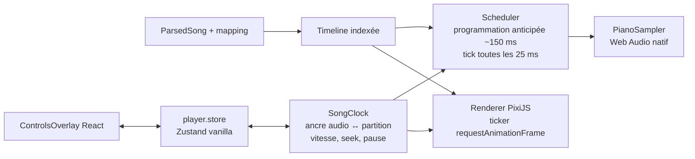

# Open Keys — Architecture : Moteur du lecteur

[← Sommaire](./README.md)

Principe : **une seule horloge**, l'horloge audio (`AudioContext.currentTime`). React ne pilote pas l'animation.
Ces choix sont **validés par le spike** de la phase 0 (D17, branche `spike/falling-notes`).

## Horloge (`engine/clock.ts`)

- **Temps de partition** : référence unique, en secondes à 100 % de vitesse (stocké en ms en base). Positions, boucles et timeline l'utilisent.
- **Ancre** : `(tempsAudio₀, tempsPartition₀, vitesse)`. Ainsi `partition(t) = tempsPartition₀ + (t − tempsAudio₀) × vitesse`. Lecture, pause, seek et changement de vitesse ne font que déplacer l'ancre.
- **Deux lectures de l'horloge** :
  - `scheduledSongTime()` à partir de `currentTime` : ce qui est envoyé au graphe audio (le scheduler s'en sert) ;
  - `heardSongTime()` à partir de **`currentTime − outputLatency − baseLatency`** : ce qui sort des haut-parleurs (le renderer s'en sert).
- **Pourquoi pas `getOutputTimestamp()`** : sous Firefox, il n'intègre pas la latence de sortie. On a mesuré 0 ms, alors que Firefox annonce 42 ms de latence, et l'image passerait environ 40 ms avant le son. Sous Chrome, il donne la même chose que la formule ci-dessus. La formule est donc la seule cohérente sur les deux navigateurs.
- **Décalage manuel** (réglage avancé) : un offset en ms appliqué à `heardSongTime()`, pour un matériel qui annoncerait mal sa latence (par exemple un casque Bluetooth).

## Audio (`audio/piano-sampler.ts`)

- **Web Audio natif, sans Tone.js.** Tone enveloppe l'`AudioContext` (avec `standardized-audio-context`) : ça masque `outputLatency`, et sous Firefox l'injection d'un contexte natif plante (`param must be an AudioParam`). Un sampler maison d'environ 120 lignes suffit :
  - l'échantillon Salamander le plus proche (un toutes les tierces mineures), transposé par `playbackRate` ;
  - une enveloppe de volume selon la vélocité, et un relâchement exponentiel (`setTargetAtTime`) ;
  - un `DynamicsCompressor` en sortie, contre la saturation dans les passages denses ;
  - un arrêt global en fondu rapide (30 ms) pour la pause et le seek.
- **Pédale de sustain** : elle prolonge le **son** (`soundEnd`) mais **pas l'affichage**. La note qui tombe montre la durée d'appui sur la touche (`end`). Sinon, les arpèges sous pédale deviennent illisibles.
- **Échantillons** : servis par le conteneur `web` et mis en cache par le Service Worker. Le spike utilisait le CDN de Tone.js.

## Scheduler (`engine/scheduler.ts`)

- Il tourne toutes les **25 ms** (`setInterval`), plus un passage immédiat au démarrage.
- Il programme les notes dont le début tombe dans les **150 ms** à venir (en temps réel), à leur instant audio exact.
- Une note qui aurait dû commencer il y a plus de 20 ms est **sautée** (comptée, jamais jouée en retard).
- Boucle : au passage de B, il fait un seek sur A puis une réinitialisation, et les notes sont coupées à B.
- Vitesse : la durée audio d'une note est `(soundEnd − start) / vitesse`. La hauteur des notes ne change pas.

## Renderer (`renderer/`)

- PixiJS v8 (WebGL), avec un **pool de `Sprite(Texture.WHITE)`** teintés : aucune allocation par image.
- À chaque image, une recherche dichotomique trouve la première note dont `start ≥ now − durée max`, puis on parcourt jusqu'à l'horizon.
- **La vitesse de chute est constante en temps réel** : une note met toujours 2,5 s à traverser l'écran, quelle que soit la vitesse de lecture. À 50 %, les notes paraissent donc deux fois plus longues.
- Le clavier n'est redessiné qu'au changement de taille ou de zoom. Une surcouche teintée par touche s'allume pendant qu'une note est jouée.
- Mesuré au spike : **environ 0,1 ms de rendu par image** sur l'Étude op. 10 n°1, avec environ 35 notes à l'écran.

## Couche d'entrée (V2)

L'interface `InputSource { onNoteOn, onNoteOff, dispose }`. Le moteur ne connaît pas l'origine des événements.
