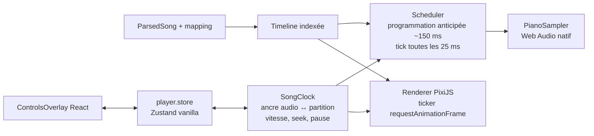

# Open Keys — Architecture : Moteur du lecteur

[← Sommaire](./README.md)

Principe : **une seule horloge**, l'horloge audio (`AudioContext.currentTime`). React ne pilote pas l'animation.
Ces choix sont **validés par le spike** de la phase 0 (D17, branche `spike/falling-notes`).

## Horloge (`engine/song-clock.ts`)

- **Temps de partition** : référence unique, en secondes à 100 % de vitesse (stocké en ms en base). Positions, boucles et timeline l'utilisent.
- **Ancre** : `(tempsAudio₀, tempsPartition₀, vitesse)`. Ainsi `partition(t) = tempsPartition₀ + (t − tempsAudio₀) × vitesse`. Lecture, pause, seek et changement de vitesse ne font que déplacer l'ancre.
- **Deux lectures de l'horloge** :
  - `scheduledSongTime()` à partir de `currentTime` : ce qui est envoyé au graphe audio (le scheduler s'en sert) ;
  - `heardSongTime()` à partir de **`currentTime − outputLatency − baseLatency`** : ce qui sort des haut-parleurs (le renderer s'en sert).
- **Pourquoi pas `getOutputTimestamp()`** : sous Firefox, il n'intègre pas la latence de sortie. On a mesuré 0 ms, alors que Firefox annonce 42 ms de latence, et l'image passerait environ 40 ms avant le son. Sous Chrome, il donne la même chose que la formule ci-dessus. La formule est donc la seule cohérente sur les deux navigateurs.
- **Décalage manuel** (réglage avancé) : un offset en ms appliqué à `heardSongTime()`, pour un matériel qui annoncerait mal sa latence (par exemple un casque Bluetooth).

## Audio (`audio/piano-sampler.ts`)

- **Web Audio natif, sans Tone.js.** Tone enveloppe l'`AudioContext` (avec `standardized-audio-context`) : ça masque `outputLatency`, et sous Firefox l'injection d'un contexte natif plante (`param must be an AudioParam`). Un sampler maison d'environ 120 lignes suffit :
  - l'échantillon Salamander le plus proche (un toutes les tierces mineures), transposé par `playbackRate` ;
  - une enveloppe de volume selon la vélocité, et un relâchement exponentiel (`setTargetAtTime`) ;
  - un `DynamicsCompressor` en sortie, contre la saturation dans les passages denses ;
  - un arrêt global en fondu rapide (30 ms) pour la pause et le seek.
- **Pédale de sustain** : elle prolonge le **son** (`soundEnd`) mais **pas l'affichage**. La note qui tombe montre la durée d'appui sur la touche (`end`). Sinon, les arpèges sous pédale deviennent illisibles.
- **Échantillons** : 30 fichiers MP3 Salamander (un toutes les tierces mineures, **une seule couche de vélocité**, environ 2 Mo) dans `apps/web/public/samples/salamander/`, servis par le conteneur `web`. La vélocité module le volume. Ils sont précachés par le Service Worker.

## Scheduler (`engine/note-scheduler.ts`)

- Il tourne toutes les **25 ms** (`setInterval`), plus un passage immédiat au démarrage.
- Il programme les notes dont le début tombe dans les **150 ms** à venir (en temps réel), à leur instant audio exact.
- Une note qui aurait dû commencer il y a plus de 20 ms est **sautée** (comptée, jamais jouée en retard).
- Boucle : au passage de B, il fait un seek sur A puis une réinitialisation, et les notes sont coupées à B.
- Vitesse : la durée audio d'une note est `(soundEnd − start) / vitesse`. La hauteur des notes ne change pas.

## Renderer (`renderer/`)

- PixiJS v8 (WebGL), avec un **pool de `Sprite(Texture.WHITE)`** teintés : aucune allocation par image.
- À chaque image, une recherche dichotomique trouve la première note dont `start ≥ now − durée max`, puis on parcourt jusqu'à l'horizon.
- **La vitesse de chute est constante en temps réel** : une note met toujours 2,5 s à traverser l'écran, quelle que soit la vitesse de lecture. À 50 %, les notes paraissent donc deux fois plus longues.
- Le clavier n'est redessiné qu'au changement de taille ou de zoom. Une surcouche teintée par touche s'allume pendant qu'une note est jouée.
- Mesuré au spike : **environ 0,1 ms de rendu par image** sur l'Étude op. 10 n°1, avec environ 35 notes à l'écran.

## Couche d'entrée (V2)

L'interface `InputSource { onNoteOn, onNoteOff, dispose }`. Le moteur ne connaît pas l'origine des événements.

## Interface (`controller/`, `stores/`, `components/`)

- **Le contrôleur est le seul point d'action** : les composants appellent `play`, `seekBy`, `setTempo`, `markLoopStart`/`markLoopEnd`, `toggleHand`, `toggleZoom`… et lisent le store. Le contrôleur garde moteur, rendu et store cohérents.
- **Store Zustand vanilla** : position (rafraîchie toutes les 100 ms pendant la lecture), vitesse, boucle, mains, zoom. Le rendu PixiJS ne passe jamais par React.
- **Runtime navigateur isolé** (`runtime/browser-runtime.ts`) : AudioContext, sampler, renderer WebGL. Dans les tests de composants, il est remplacé par des faux (`vi.mock`), et tout le reste du lecteur est réel.
- **Le runtime appartient à la page** (`hooks/use-player-runtime.ts`) : il est créé dès l'ouverture du lecteur, et le décodage des échantillons (l'étape la plus longue, ≈ 1,2 s) se fait pendant le chargement du morceau. La session (`use-player-session.ts`) construit ensuite le moteur et le rendu sur ce runtime.
- **Contrôles** : visibles à la pause. Pendant la lecture, ils se masquent après 3 s sans interaction et réapparaissent au toucher ou au mouvement de la souris. La partie basse se place juste au-dessus du clavier, selon la même règle de hauteur que le rendu (20 % de l'écran, entre 56 et 170 px).
- **Zoom automatique** : activé par défaut quand le plus petit côté de l'écran fait moins de 600 px (téléphone, quelle que soit l'orientation). Le clavier cadre alors la plage du morceau, avec 2 touches de marge.
- **Raccourcis (PC)** : `Espace` lecture/pause, `←`/`→` ±5 s, `↑`/`↓` vitesse ±5 %, `A`/`B` bornes de boucle, `L` boucle on/off, `1`/`2` son de la main gauche/droite, `Z` zoom, `F` plein écran, `Échap` quitter.
- **Plein écran** avec verrouillage en paysage quand le navigateur le permet, et **Wake Lock** pendant la lecture.

## Reprise et pratique (`hooks/use-practice-persistence.ts`)

- À la pause, quand l'onglet est masqué et en quittant le lecteur, la bibliothèque est mise à jour : position, vitesse, mains, boucle active et date de pratique. Les requêtes partent avec `keepalive` pour survivre à la fermeture de la page.
- **Une session par visite** : un ULID créé à l'ouverture et renvoyé à chaque sauvegarde. Le `PUT` est idempotent, et la session n'est enregistrée qu'au-delà de 10 s de lecture effective.
- Pratiquer un morceau « à apprendre » le passe automatiquement **« en cours »**.
- À l'ouverture : reprise de la position (sauf dans la dernière seconde du morceau), de la vitesse, des mains et de la dernière boucle active.

## Mesures (build de production)

Temps jusqu'au bouton Lecture actif, depuis la navigation, sur le PC de développement :

| Navigateur | Cache vide (phase 3) | Service Worker, échantillons en cache | Lecture |
|---|---|---|---|
| Chrome headless | 2,6 – 3,2 s | **1,6 – 2,0 s** (images Docker, CSP active) | ✅ position qui avance, aucune erreur |
| Firefox headless | 3,6 – 4,3 s | 2,4 – 3,4 s | ✅ position qui avance |

- **Les échantillons sont précachés, et le décodage est lancé en parallèle du chargement du morceau.** Le décodage des 30 MP3 (≈ 400 s d'audio stéréo) reste le poste principal : ≈ 1,2 à 1,4 s en headless, sans accélération matérielle.
- L'objectif « < 2 s » reste à confirmer sur le Pixel 10.
- S'il n'est pas tenu, deux leviers sans changer l'architecture : des échantillons **mono** (décodage et mémoire divisés par deux) ou **raccourcis** à une dizaine de secondes avec un fondu.

