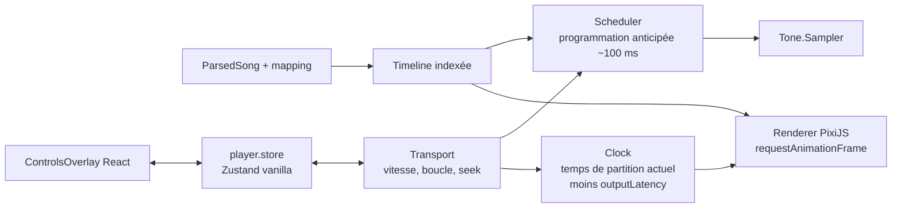

# Open Keys — Architecture : Moteur du lecteur

[← Sommaire](./README.md)

Principe : **une seule horloge**, l'horloge audio. React ne pilote pas l'animation.

- **Temps de partition** : référence unique, en ms à 100 %. Positions, boucles et timeline l'utilisent.
- **Vitesse** : appliquée sur le Transport. La hauteur des notes est conservée, puisque le son est recalculé à partir du MIDI.
- **Synchro** : à chaque image, le renderer lit `clock.now()` = temps du Transport − latence de sortie, puis dessine les notes de la fenêtre `[now, now + horizon]` grâce à une recherche dichotomique dans la timeline.
- **Performance** : objets graphiques réutilisés (pool de `Graphics`/`Sprite`), aucune allocation dans la boucle de rendu, aucun rendu React pendant la lecture.
- **Couche d'entrée (V2)** : l'interface `InputSource { onNoteOn, onNoteOff, dispose }`. Le moteur ne connaît pas l'origine des événements.
