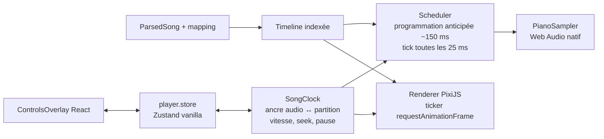

# Open Keys — Architecture : Moteur du lecteur

[← Sommaire](./README.md)

Principe : **une seule horloge**, l'horloge audio (`AudioContext.currentTime`). React ne pilote pas l'animation.
Ces choix sont **validés par le spike** de la phase 0 (D17, branche `spike/falling-notes`).

## Horloge (`engine/song-clock.ts`)

- **Temps de partition** : référence unique, en secondes à 100 % de vitesse (stocké en ms en base). Positions, boucles et timeline l'utilisent.
- **Ancre** : `(tempsAudio₀, tempsPartition₀, vitesse)`. Ainsi `partition(t) = tempsPartition₀ + (t − tempsAudio₀) × vitesse`. Lecture, pause, seek et changement de vitesse ne font que déplacer l'ancre.
- **Deux lectures de l'horloge** :
  - `scheduledSongTime()` à partir de `currentTime` : ce qui est envoyé au graphe audio (le scheduler s'en sert) ;
  - `heardSongTime()` à partir de **`currentTime − outputLatency − baseLatency`** : ce qui sort des haut-parleurs (le renderer s'en sert).
- **Pourquoi pas `getOutputTimestamp()`** : sous Firefox, il n'intègre pas la latence de sortie. On a mesuré 0 ms, alors que Firefox annonce 42 ms de latence, et l'image passerait environ 40 ms avant le son. Sous Chrome, il donne la même chose que la formule ci-dessus. La formule est donc la seule cohérente sur les deux navigateurs.
- **Décalage manuel** (réglage avancé) : un offset en ms appliqué à `heardSongTime()`, pour un matériel qui annoncerait mal sa latence (par exemple un casque Bluetooth).

## Audio (`audio/piano-sampler.ts`)

- **Web Audio natif, sans Tone.js.** Tone enveloppe l'`AudioContext` (avec `standardized-audio-context`) : ça masque `outputLatency`, et sous Firefox l'injection d'un contexte natif plante (`param must be an AudioParam`). Un sampler maison d'environ 120 lignes suffit :
  - l'échantillon Salamander le plus proche (un toutes les tierces mineures), transposé par `playbackRate` ;
  - une enveloppe de volume selon la vélocité, et un relâchement exponentiel (`setTargetAtTime`) ;
  - un `DynamicsCompressor` en sortie, contre la saturation dans les passages denses ;
  - un arrêt global en fondu rapide (30 ms) pour la pause et le seek.
- **Pédale de sustain** : elle prolonge le **son** (`soundEnd`) mais **pas l'affichage**. La note qui tombe montre la durée d'appui sur la touche (`end`). Sinon, les arpèges sous pédale deviennent illisibles.
- **Échantillons** : 30 fichiers MP3 Salamander (un toutes les tierces mineures, **une seule couche de vélocité**, environ 2 Mo) dans `apps/web/public/samples/salamander/`, servis par le conteneur `web`. La vélocité module le volume. Ils sont précachés par le Service Worker.

## Scheduler (`engine/note-scheduler.ts`)

- Il tourne toutes les **25 ms** (`setInterval`), plus un passage immédiat au démarrage.
- Il programme les notes dont le début tombe dans les **150 ms** à venir (en temps réel), à leur instant audio exact.
- Une note qui aurait dû commencer il y a plus de 20 ms est **sautée** (comptée, jamais jouée en retard).
- Boucle : au passage de B, il fait un seek sur A puis une réinitialisation, et les notes sont coupées à B.
- Vitesse : la durée audio d'une note est `(soundEnd − start) / vitesse`. La hauteur des notes ne change pas.

## Renderer (`renderer/`)

- PixiJS v8 (WebGL), avec un **pool de `Sprite(Texture.WHITE)`** teintés : aucune allocation par image.
- À chaque image, une recherche dichotomique trouve la première note dont `start ≥ now − durée max`, puis on parcourt jusqu'à l'horizon.
- **La vitesse de chute est constante en temps réel** : une note met toujours 2,5 s à traverser l'écran, quelle que soit la vitesse de lecture. À 50 %, les notes paraissent donc deux fois plus longues.
- Le clavier n'est redessiné qu'au changement de taille ou de zoom. Une surcouche teintée par touche s'allume pendant qu'une note est jouée.
- Mesuré au spike : **environ 0,1 ms de rendu par image** sur l'Étude op. 10 n°1, avec environ 35 notes à l'écran.

## Écoute au micro (V1.5, D30)

- **`core/listening`** : `Spectrum` (FFT radix-2, fenêtre de Hann, sans allocation par trame), `PitchDetector` et `NoteListener`. Une trame toutes les 1024 échantillons (21 ms à 48 kHz) sur les 8192 derniers (170 ms).
- **`verify(expected)`** : pour chaque note attendue, sur le spectre sans les autres notes attendues, trois tests. Elle bat ses voisins d'un demi-ton non attendus. Ses harmoniques impaires portent au moins 36 % de sa saillance. L'octave inférieure non attendue en explique moins de 45 %. Une note compte quand elle est entendue dans 2 trames de suite.
- **`detect()`** : transcription libre (estimation itérative de Klapuri), pour l'affichage du labo seulement.
- **Banc d'essai** (`pnpm --filter @open-keys/server listening:benchmark [bruit-dB]`, avec les échantillons Salamander, ffmpeg requis) : accords à deux mains justes acceptés à 94 % (médiane 127 ms après la frappe), demi-ton faux refusé à 89 %, octave fausse refusée à 78 %. Un vrai piano dans une vraie pièce (réverbération, bruits) sera plus difficile : à mesurer avec le labo.
- **Labo micro** (`/lab/micro`, lien dans « Mon compte ») : niveau du micro, notes entendues, et vérification de quelques accords (do4, do majeur, deux mains, octave, grave), avec le délai mesuré.
- **Capture** : `getUserMedia` sans annulation d'écho, réduction de bruit ni gain automatique, et un AudioWorklet (`public/worklets/mic-capture.js`, fichier servi par l'app pour respecter la CSP) qui transmet les échantillons.

## Couche d'entrée (V2)

L'interface `InputSource { onNoteOn, onNoteOff, dispose }`. Le moteur ne connaît pas l'origine des événements.

## Interface (`controller/`, `stores/`, `components/`)

- **Le contrôleur est le seul point d'action** : les composants appellent `play`, `seekBy`, `setTempo`, `markLoopStart`/`markLoopEnd`, `toggleHand`, `toggleZoom`… et lisent le store. Le contrôleur garde moteur, rendu et store cohérents.
- **Store Zustand vanilla** : position (rafraîchie toutes les 100 ms pendant la lecture), vitesse, boucle, mains, zoom. Le rendu PixiJS ne passe jamais par React.
- **Runtime navigateur isolé** (`runtime/browser-runtime.ts`) : AudioContext, sampler, renderer WebGL. Dans les tests de composants, il est remplacé par des faux (`vi.mock`), et tout le reste du lecteur est réel.
- **Le runtime appartient à la page** (`hooks/use-player-runtime.ts`) : il est créé dès l'ouverture du lecteur, et le décodage des échantillons (l'étape la plus longue, ≈ 1,2 s) se fait pendant le chargement du morceau. La session (`use-player-session.ts`) construit ensuite le moteur et le rendu sur ce runtime.
- **Contrôles**, réduits à l'essentiel (D27) :
  - en haut : retour, titre, plein écran, **Réglages** et **Boucles**. Le bouton Réglages affiche la vitesse quand elle n'est pas à 100 %, le bouton Boucles s'allume quand une boucle est active ;
  - au centre : −5 s, lecture/pause, +5 s ;
  - la **barre de progression** est posée sur le bord entre les notes et le clavier (même règle de hauteur que le rendu : 20 % de l'écran, entre 56 et 170 px), avec les temps au-dessus ;
  - visibles à la pause, **masqués dès le lancement de la lecture** (fondu de 200 ms) ;
  - un tap sur une zone vide ferme le panneau ouvert, sinon masque les contrôles, y compris à la pause ;
  - un tap, un mouvement de **souris** ou une touche les réaffiche. Un doigt qui bouge pendant un tap ne compte pas, ni la souris dans les 600 ms qui suivent un tap qui les a masqués. Pendant la lecture, ils se masquent à nouveau après 3 s sans interaction, **sauf tant qu'un panneau est ouvert** (A et B se posent pendant la lecture).
- **Panneaux** : un seul ouvert à la fois, sous la barre du haut. Sur un écran de moins de 500 px de haut (téléphone en paysage), ils prennent toute la hauteur à droite, et les notes restent visibles à gauche.
- **Zoom automatique** : activé par défaut quand le plus petit côté de l'écran fait moins de 600 px (téléphone, quelle que soit l'orientation). Le clavier cadre alors la plage du morceau, avec 2 touches de marge.
- **Raccourcis (PC)** : `Espace` lecture/pause, `←`/`→` ±5 s, `↑`/`↓` vitesse ±5 %, `A`/`B` bornes de boucle, `L` boucle on/off, `1`/`2` son de la main gauche/droite, `Z` zoom, `M` métronome, `C` décompte, `N` nom des notes (aucun → notes → touches → les deux), `F` plein écran, `Échap` quitter.
- **Réglages** : vitesse, mains (son, affichage, volume), zoom, nom des notes, décompte et métronome.
- **Boucles** : bornes A et B, boucle on/off, vitesse cible, boucles enregistrées.
- **Plein écran** avec verrouillage en paysage quand le navigateur le permet, et **Wake Lock** pendant la lecture.

## Confort (V1.2, D25)

- **Grille de temps** (`core`, `beatGrid`) : calculée depuis la carte des tempos et les signatures rythmiques du MIDI (4/4 par défaut). Une pulsation par unité de la signature : noire en 4/4 ou 3/4, croche en 6/8. Un fichier enregistré sans clic (interprétation libre, MAESTRO) a une grille qui ne suit pas la musique.
- **Métronome** (`audio/metronome.ts`) : clics synthétisés (oscillateur, 35 ms, aucun échantillon), programmés par le scheduler sur l'horloge audio comme les notes, avec la même anticipation. Le premier temps de la mesure est plus aigu et plus fort.
- **Décompte** : une mesure de clics de la signature et du tempo à la position, à la vitesse courante. L'horloge démarre une mesure plus tard (`SongClock.play(delay)`), et le temps du morceau court aussi avant l'ancre : **les notes descendent déjà pendant le décompte**. Au retour en début de boucle, même principe (`seek(start, delay)`). Le grand chiffre « 3, 2, 1 » suit les clics : une mise à jour du store par temps.
- **Nom des notes** (notation anglaise, dièses) : sur les notes qui tombent (étiquettes réutilisées comme les notes, seulement quand elles tiennent) et/ou sur les touches (les C gardent leur octave).
- **Volume par main** : appliqué à la vélocité des notes de la main. Enregistré avec les réglages des mains du morceau (`hands_settings.volume`).
- **Préférences de l'appareil** : décompte, métronome et nom des notes, gardés dans le `localStorage` (illisibles ou absents : valeurs par défaut). Pas synchronisés : un téléphone sur trépied et un PC ne s'utilisent pas de la même façon.

## Progression par boucle (V1.3, UC-26)

- Chaque tour complet de la boucle est compté à la vitesse courante (`engine.onLoopRestart`). Changer de vitesse ou de boucle remet le compte à zéro.
- **Meilleure vitesse** : la vitesse courante, dès **3 tours de suite**, si elle dépasse la meilleure connue. Sans entrée MIDI (V2), l'app ne sait pas si les notes étaient justes : « réussi » veut dire « joué en entier plusieurs fois de suite ».
- **Proposition d'accélérer** après **5 tours de suite**, de 5 % et jusqu'à la vitesse cible de la boucle (100 % par défaut). Visible même quand les contrôles sont masqués. « Plus tard » attend 5 nouveaux tours.
- Vitesse cible réglable dans le panneau des boucles. Les deux vitesses d'une boucle enregistrée sont sauvegardées comme toute modification de boucle (outbox, hors-ligne compris).

## Répartition des mains (`core/hands`, D28)

- **`separateHands`** : les notes sont regroupées en accords (attaques à moins de 35 ms) et triées par hauteur. Pour chaque accord, chaque coupure possible (notes graves à gauche, aiguës à droite) est notée :
  - déplacement de chaque main depuis sa dernière position ;
  - écart au-delà d'une dixième dans une main, et plus de 5 touches ; les touches encore tenues comptent moins, car une longue note est souvent tenue par la pédale ;
  - main gauche au-dessus de la droite, et chaque main hors de son registre habituel.
- Une **recherche en faisceau** (12 hypothèses) garde les suites les moins coûteuses sur tout le morceau : un passage plus loin peut corriger un choix fait plus tôt. Quelques dizaines de millisecondes par morceau.
- Les poids (`DEFAULT_SEPARATION_WEIGHTS`) ont été réglés sur la moitié d'un corpus Mutopia et vérifiés sur l'autre moitié. `pnpm --filter @open-keys/server hands:benchmark <dossier>` refait la mesure : à relancer après toute modification, et augmenter alors `HAND_SEPARATION_VERSION`.
- **Encodage** (`note-hands.ts`) : une main par note dans l'ordre canonique (piste, ticks, hauteur) et l'empreinte de ces notes. `buildTimeline` reçoit les mains décodées ; si elles ne correspondent pas au fichier, la timeline revient aux pistes.

## Reprise et pratique (`hooks/use-practice-persistence.ts`)

- À la pause, quand l'onglet est masqué et en quittant le lecteur, la bibliothèque est mise à jour : position, vitesse, mains, boucle active et date de pratique. Les requêtes partent avec `keepalive` pour survivre à la fermeture de la page.
- **Une session par visite** : un ULID créé à l'ouverture et renvoyé à chaque sauvegarde. Le `PUT` est idempotent, et la session n'est enregistrée qu'au-delà de 10 s de lecture effective.
- Pratiquer un morceau « à apprendre » le passe automatiquement **« en cours »**.
- À l'ouverture : reprise de la position (sauf dans la dernière seconde du morceau), de la vitesse, des mains et de la dernière boucle active.

## Mesures (build de production)

Temps jusqu'au bouton Lecture actif, depuis la navigation, sur le PC de développement :

| Navigateur | Cache vide (phase 3) | Service Worker, échantillons en cache | Lecture |
|---|---|---|---|
| Chrome headless | 2,6 – 3,2 s | **1,6 – 2,0 s** (images Docker, CSP active) | ✅ position qui avance, aucune erreur |
| Firefox headless | 3,6 – 4,3 s | 2,4 – 3,4 s | ✅ position qui avance |

- **Les échantillons sont précachés, et le décodage est lancé en parallèle du chargement du morceau.** Le décodage des 30 MP3 (≈ 400 s d'audio stéréo) reste le poste principal : ≈ 1,2 à 1,4 s en headless, sans accélération matérielle.
- L'objectif « < 2 s » reste à confirmer sur le Pixel 10.
- S'il n'est pas tenu, deux leviers sans changer l'architecture : des échantillons **mono** (décodage et mémoire divisés par deux) ou **raccourcis** à une dizaine de secondes avec un fondu.

