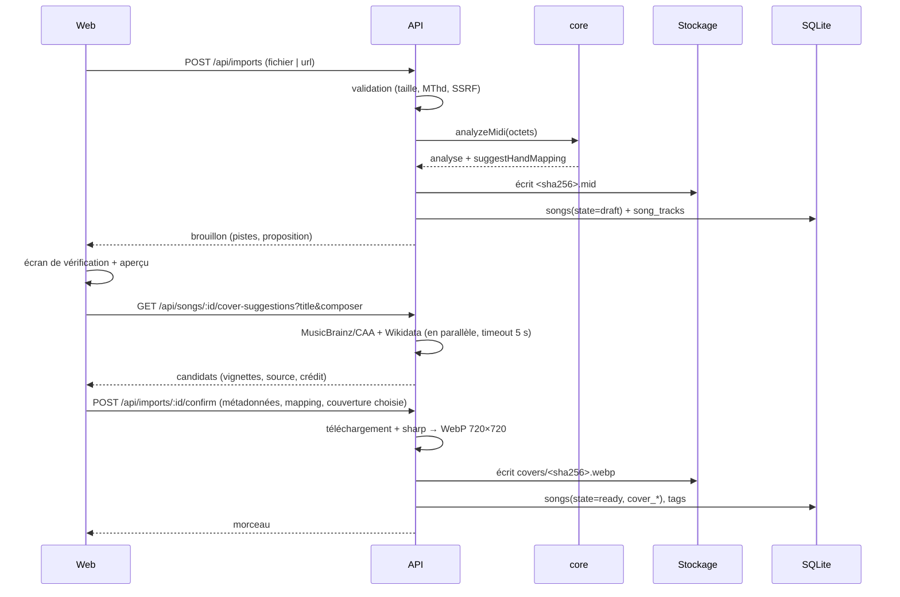
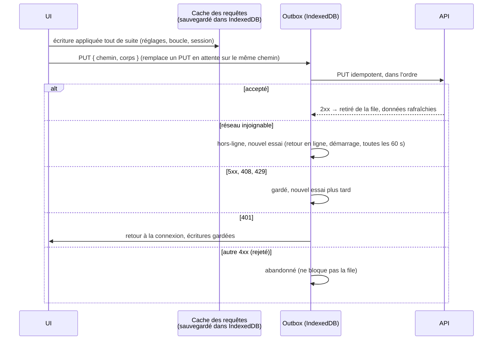

# Open Keys — Architecture : Flux principaux

[← Sommaire](./README.md)

## Import

## Synchronisation hors-ligne

- **Écriture** : toujours locale d'abord, en ligne comme hors-ligne. Une boucle est supprimée par un `PUT` avec `deletedAt` (suppression logique) : l'outbox ne contient que des `PUT`.
- **Connectivité** : partagée avec TanStack Query (`onlineManager`). Une requête qui n'atteint pas l'API passe l'app hors-ligne : les requêtes se mettent en pause et gardent leurs données. Une sonde de `/api/health` toutes les 15 s, ou l'événement `online` du navigateur, la repasse en ligne.
- **Lecture hors-ligne** : le cache des requêtes est restauré avant le premier rendu (la garde d'authentification voit l'utilisateur). Les MIDI viennent de `midiFiles`. Les favoris y sont téléchargés en arrière-plan quand on est en ligne.
