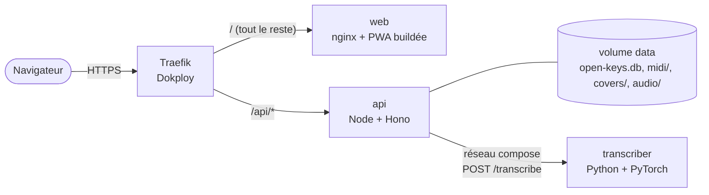

# Open Keys — Architecture : Déploiement

[← Sommaire](./README.md)

## Topologie

Trois conteneurs orchestrés par un `docker-compose.yml`, déployé comme application compose dans Dokploy. **Il n'y a pas de conteneur de base de données** : SQLite est un fichier dans le volume de l'API (D5).



- **Un seul domaine** : Traefik envoie `/api/*` vers `api` et tout le reste vers `web`. Le front et l'API ont donc la même origine : pas de CORS, et les cookies `SameSite=Lax` fonctionnent sans configuration particulière.
- Les services se déploient **indépendamment** : une modif du front ne redémarre pas l'API.
- Le `transcriber` n'a **pas de domaine** : seule l'API le joint, sur le réseau du compose.

## Fichiers

| Fichier | Rôle |
|---|---|
| `docker-compose.yml` | Production : services `web` et `api`, volume `data`. Les domaines sont configurés dans Dokploy |
| `docker/web.Dockerfile` | Build Vite, puis `nginxinc/nginx-unprivileged` (port 8080, utilisateur non root) |
| `docker/api.Dockerfile` | Build tsdown, `pnpm deploy --prod`, puis `node:26-slim` (utilisateur `node`) |
| `docker/transcriber.Dockerfile` | `python:3.12-slim`, ffmpeg, PyTorch pour le CPU, le modèle de ByteDance vérifié par son empreinte (utilisateur non root) |
| `docker/nginx/default.conf` | Repli SPA, cache, compression |
| `docker/nginx/security-headers.conf` | CSP et en-têtes de sécurité, inclus dans chaque `location` |
| `docker/compose.local.yml` + `docker/Caddyfile` | Production en local, avec Caddy dans le rôle de Traefik |
| `.dockerignore` | Contexte de build réduit aux sources |

## Services

| Service | Image | Rôle | Exposé |
|---|---|---|---|
| `web` | `docker/web.Dockerfile` | Sert `apps/web/dist` (PWA) | `/` via Traefik, port 8080 |
| `api` | `docker/api.Dockerfile` | API Hono, migrations, tâches différées | `/api` via Traefik, port 3000 |
| `transcriber` | `docker/transcriber.Dockerfile` | Enregistrement de piano → MIDI (D34) | Non : réseau du compose, port 8000 |

### `web` (nginx)
- **Build multi-stage** : `pnpm fetch` (couche réutilisée tant que le lockfile ne change pas), installation hors ligne, `pnpm --filter @open-keys/web build`, puis copie de `dist/` dans nginx.
- **Repli SPA** : `try_files $uri /index.html`.
- **Cache** :
  - `assets/*` (fichiers hashés par Vite) et `samples/*` : `Cache-Control: public, max-age=31536000, immutable` ;
  - `index.html`, `sw.js`, `workbox-*.js` et `manifest.webmanifest` : `no-cache`, pour que les mises à jour de la PWA soient prises en compte.
- **Compression** gzip.
- **En-têtes de sécurité** posés ici pour les pages, et par Hono pour l'API :
  - `Content-Security-Policy` sans `unsafe-eval` ni script inline. Deux conséquences dans le code :
    - PixiJS est chargé avec `pixi.js/unsafe-eval`, qui remplace la génération de code des shaders. Sans lui, le rendu échoue.
    - zod est configuré en `jitless` (`main.tsx`).
    
    Firefox signale quand même une violation par chargement du lecteur : c'est le test interne de PixiJS (`new Function` dans un `try`), sans effet sur le rendu.
  - `img-src` autorise les vignettes de Cover Art Archive et Wikimedia (voir [sécurité](./08-securite.md)).
  - `X-Content-Type-Options`, `Referrer-Policy`, `Permissions-Policy`.

### `api` (Node + Hono)
- **Build multi-stage** : tsdown embarque `packages/*` dans `dist/index.mjs`, puis `pnpm deploy --prod` produit les seules dépendances de production. `better-sqlite3` et `sharp` utilisent leurs binaires précompilés (glibc), d'où l'image Debian slim et non Alpine.
- **Volume** `data` monté sur `/data` : `open-keys.db` (SQLite en mode WAL), `midi/`, `covers/`, `sources/` (archive MAESTRO extraite, environ 85 Mo). Le dossier appartient à l'utilisateur `node` dans l'image, et le volume nommé hérite de ces droits à sa création.
- **Au démarrage** : migrations Drizzle appliquées, puis création de l'utilisateur initial à partir de `ADMIN_USERNAME`/`ADMIN_PASSWORD` s'il n'existe pas.
- **Healthcheck** : `GET /api/health`.
- **Arrêt propre** : sur `SIGTERM` (redéploiement Dokploy), le serveur arrête d'accepter des connexions et termine les requêtes en cours. Il est forcé au bout de 10 s (`stop_grace_period: 15s` dans le compose).
- **Une seule instance** : SQLite n'accepte qu'un seul processus qui écrit. On ne passe pas l'API à l'échelle horizontalement, et ce n'est pas un besoin.

### `transcriber` (Python)
- **Rôle** : `POST /transcribe` reçoit un enregistrement (tout ce que lit ffmpeg) et renvoie le MIDI, avec les notes, la pédale et la grille de temps. `GET /health` sert au healthcheck. Le code est dans `apps/transcriber`.
- **Image** : environ 3 Go, à cause de PyTorch pour le CPU, de librosa et du modèle de 172 Mo. Le modèle est téléchargé au build depuis Zenodo et vérifié par son SHA-256, puis chargé en mode sûr (`weights_only`, des poids sans code).
- **Ressources** :
  - une transcription à la fois, sur tous les cœurs, avec environ 1 Go de RAM pendant le calcul ;
  - environ 2 fois la durée de l'enregistrement sur 4 cœurs ;
  - `TRANSCRIBER_THREADS` limite les cœurs utilisés, pour garder de la marge au reste du VPS.
- **Occupé** : répond 503 avec `Retry-After`. L'API envoie de toute façon les tâches une par une, et remet la tâche en file si le service ne répond pas.
- **Sans transcriber** : si `TRANSCRIBER_URL` est vide, l'API annonce l'import d'enregistrements indisponible, et l'onglet le dit.

## PWA (Service Worker)

- `vite-plugin-pwa` (Workbox, `generateSW`) génère `sw.js` et `manifest.webmanifest`.
- **Précache** (≈ 3,3 Mo) : shell de l'app (JS, CSS, HTML), polices latines et les 30 échantillons du piano. Les autres sous-ensembles de polices sont mis en cache à la première utilisation.
- **L'API n'est pas servie par le Service Worker**, sauf les couvertures (cache-first, URL versionnée par le hash). Les données hors-ligne sont dans IndexedDB (voir [flux](./05-flux.md#synchronisation-hors-ligne)).
- **Mise à jour automatique, au bon moment** (`registerType: "prompt"`, appliquée par `use-auto-update.ts`) :
  - une nouvelle version trouvée dans les 15 s qui suivent l'ouverture de l'app est appliquée tout de suite (rechargement) ;
  - sinon, elle attend le changement de page suivant, pour ne jamais recharger un formulaire en cours de saisie ;
  - jamais dans le lecteur (le hook n'est monté que dans le shell des autres pages) : elle s'applique en le quittant ;
  - l'app vérifie la présence d'une nouvelle version toutes les heures.
- L'enregistrement est fait par l'app (`app/pwa/register-service-worker.ts`), sans script inline (CSP).

## Variables d'environnement (`api`)

| Variable | Défaut | Rôle |
|---|---|---|
| `NODE_ENV` | `development` (`production` dans l'image) | `production` exige `PUBLIC_URL` et active les cookies `Secure` |
| `PORT` | `3000` | |
| `APP_VERSION` | `dev` | Exposée par `/api/health` et dans le `User-Agent` sortant (argument de build) |
| `LOG_LEVEL` | `info` | `debug`, `info`, `warn`, `error` |
| `DATA_DIR` | `./data` (`/data` dans l'image) | `open-keys.db`, `midi/`, `covers/` |
| `PUBLIC_URL` | — | Origine publique (`https://…`) : seule origine acceptée pour les envois de formulaire |
| `ADMIN_USERNAME` / `ADMIN_PASSWORD` | — | Compte initial, créé au démarrage s'il n'existe aucun utilisateur (12 caractères minimum) |
| `COOKIE_SECURE` | `true` en production | Cookie de session HTTPS uniquement |
| `TRUST_PROXY` | `false` (`true` dans le compose) | `true` derrière Traefik : l'IP cliente vient de `X-Forwarded-For` |
| `MAX_MIDI_SIZE` / `MAX_COVER_SIZE` | 2 Mo / 10 Mo | Limites d'upload et de téléchargement |
| `MUSICBRAINZ_CONTACT` | URL du dépôt | Contact dans le `User-Agent` envoyé à MusicBrainz, Wikimedia et aux bibliothèques en ligne (exigé par leurs règles) |
| `SOURCES_SYNC` | `true` | Synchronisation des bibliothèques en ligne (vérifiée toutes les 6 h ; Mutopia et xivmidi chaque semaine, MAESTRO chaque mois). `false` dans les tests e2e |
| `TRANSCRIBER_URL` | `http://transcriber:8000` dans le compose | Service de transcription (D34). Vide : import d'enregistrements indisponible |
| `MAX_AUDIO_SIZE` | 40 Mo | Taille maximale d'un enregistrement envoyé ou téléchargé |
| `AUDIO_SOURCES` | — | Origines dont les enregistrements peuvent être transcrits par URL et relayés au lecteur (D35), séparées par des virgules : l'app qui récupère la musique (`https://music.example.org`) |
| `INTEGRATION_TOKEN` / `INTEGRATION_USERNAME` | — | Clé de l'app qui récupère la musique (32 caractères au moins) et compte pour lequel ses envois sont importés. Les deux ensemble, ou aucun |
| `TRANSCRIBER_THREADS` (service `transcriber`) | tous les cœurs | Cœurs utilisés par une transcription |

- Elles sont toutes validées par zod au démarrage (`config/env.ts`) : une valeur invalide empêche l'API de démarrer.
- **Une valeur vide compte comme absente** : le compose passe `${VAR:-}` sous forme de chaîne vide quand la variable n'est pas définie.
- Elles sont gérées dans Dokploy et jamais commitées. Le dépôt fournit un `.env.example`.

## Mise en place dans Dokploy

À faire une fois, dans l'interface de Dokploy :

1. **Créer l'application** : *Create Service* → *Compose*, type *Docker Compose*, source GitHub (dépôt `open-keys`, branche `main`, chemin `./docker-compose.yml`).
2. **Déploiement** : géré dans Dokploy (auto-deploy sur `main` ou déploiement manuel). Dokploy construit les images sur le VPS.
3. **Variables** (onglet *Environment*) :
   ```dotenv
   PUBLIC_URL=https://keys.example.org
   ADMIN_USERNAME=pierre
   ADMIN_PASSWORD=<12 caractères minimum>
   APP_VERSION=1.0.0
   ```
   `ADMIN_*` ne sert qu'au premier démarrage, et peut être retiré ensuite.
4. **Domaines** (onglet *Domains*), avec le même hôte et HTTPS (Let's Encrypt) :

   | Service | Chemin | Port du conteneur | Strip path |
   |---|---|---|---|
   | `api` | `/api` | 3000 | non |
   | `web` | `/` | 8080 | non |

   Traefik choisit la règle la plus spécifique : `/api/*` va à l'API, le reste au web.
5. **DNS** : un enregistrement `A` du domaine vers l'IP du VPS.
6. **Premier déploiement** (*Deploy*), puis vérifier :
   - `https://<domaine>/api/health` répond `{"status":"ok",…}` ;
   - la connexion fonctionne depuis le PC et le Pixel 10.
7. **Sauvegardes** (onglet *Volume Backups*) : volume `data`, vers un stockage S3 (voir plus bas).

## Intégration continue

`.github/workflows/ci.yml` vérifie le code sur chaque PR et sur `main` : lint, types, architecture, schéma, tests et build. Le build des images Docker et le déploiement sont gérés par Dokploy, pas par la CI.

## Développement local

- `pnpm dev` : Vite (port 5173) avec un proxy `/api` vers Hono (port 3000). On garde ainsi la même origine qu'en production. Le Service Worker n'est pas actif en développement.
- **Production en local** :
  ```bash
  ADMIN_USERNAME=pierre ADMIN_PASSWORD='mot-de-passe-local' \
    docker compose -f docker-compose.yml -f docker/compose.local.yml up --build
  ```
  Ensuite, ouvrir http://localhost:8080. Caddy route comme Traefik, et `compose.local.yml` fixe `PUBLIC_URL=http://localhost:8080` et `COOKIE_SECURE=false`. Les navigateurs acceptent le Service Worker sur `localhost` sans HTTPS.

## Sauvegarde

Sauvegarde planifiée du volume `data` par Dokploy (*Volume Backups*, vers un stockage compatible S3). L'alternative est un cron `sqlite3 .backup` + rsync vers un stockage externe.
