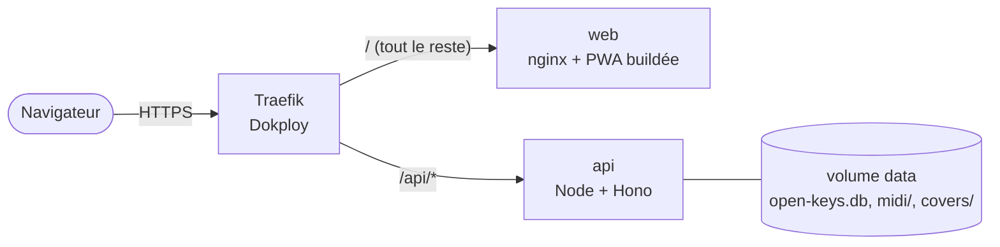

# Open Keys — Architecture : Déploiement

[← Sommaire](./README.md)

## Topologie

Deux conteneurs orchestrés par un `docker-compose.yml`, déployé comme application compose dans Dokploy. **Il n'y a pas de conteneur de base de données** : SQLite est un fichier dans le volume de l'API (D5).

- **Un seul domaine** : Traefik envoie `/api/*` vers `api` et tout le reste vers `web`. Le front et l'API ont donc la même origine : pas de CORS, et les cookies `SameSite=Lax` fonctionnent sans configuration particulière.
- Les deux services se déploient **indépendamment** : une modif du front ne redémarre pas l'API.

## Services

| Service | Image | Rôle | Exposé |
|---|---|---|---|
| `web` | `docker/web.Dockerfile` — build Vite puis `nginx:alpine` | Sert `apps/web/dist` | `/` via Traefik |
| `api` | `docker/api.Dockerfile` — build tsdown puis `node:26-slim` | API Hono, migrations, tâches différées | `/api` via Traefik |

### `web` (nginx)
- **Build multi-stage** : installation pnpm, `pnpm --filter web build`, puis copie de `dist/` dans `nginx:alpine`.
- **Repli SPA** : `try_files $uri /index.html`.
- **Cache** :
  - `assets/*` (fichiers hashés par Vite) et échantillons : `Cache-Control: public, max-age=31536000, immutable` ;
  - `index.html`, `sw.js` et `manifest.webmanifest` : `no-cache`, pour que les mises à jour de la PWA soient prises en compte.
- **Compression** gzip (et brotli si le module est disponible).
- **En-têtes de sécurité** (CSP, `X-Content-Type-Options`, `Referrer-Policy`) posés ici pour les pages, et par Hono pour l'API.

### `api` (Node + Hono)
- **Build multi-stage** : installation pnpm, build de `packages/*` et de `apps/server` (tsdown), puis image `node:26-slim` avec les dépendances de production uniquement (`better-sqlite3` et `sharp` ont des binaires précompilés pour Debian slim).
- **Volume** `data` monté sur `/data` : `open-keys.db` (SQLite en mode WAL), `midi/`, `covers/`.
- **Au démarrage** : migrations Drizzle appliquées, puis création de l'utilisateur initial à partir de `ADMIN_USERNAME`/`ADMIN_PASSWORD` s'il n'existe pas.
- **Healthcheck** : `GET /api/health`.
- **Arrêt propre** : sur `SIGTERM` (redéploiement Dokploy), le serveur arrête d'accepter des connexions et termine les requêtes en cours. Il est forcé au bout de 10 s.
- **Une seule instance** : SQLite n'accepte qu'un seul processus qui écrit. On ne passe pas l'API à l'échelle horizontalement, et ce n'est pas un besoin.

## Variables d'environnement (`api`)

| Variable | Défaut | Rôle |
|---|---|---|
| `NODE_ENV` | `development` | `production` exige `PUBLIC_URL` et active les cookies `Secure` |
| `PORT` | `3000` | |
| `APP_VERSION` | `dev` | Exposée par `/api/health` et dans le `User-Agent` sortant |
| `LOG_LEVEL` | `info` | `debug`, `info`, `warn`, `error` |
| `DATA_DIR` | `./data` | `open-keys.db`, `midi/`, `covers/` |
| `PUBLIC_URL` | — | Origine publique (`https://…`) : seule origine acceptée pour les envois de formulaire |
| `ADMIN_USERNAME` / `ADMIN_PASSWORD` | — | Compte initial, créé au démarrage s'il n'existe aucun utilisateur (12 caractères minimum) |
| `COOKIE_SECURE` | `true` en production | Cookie de session HTTPS uniquement |
| `TRUST_PROXY` | `false` | `true` derrière Traefik : l'IP cliente vient de `X-Forwarded-For` |
| `MAX_MIDI_SIZE` / `MAX_COVER_SIZE` | 2 Mo / 10 Mo | Limites d'upload et de téléchargement |
| `MUSICBRAINZ_CONTACT` | URL du dépôt | Contact dans le `User-Agent` envoyé à MusicBrainz et Wikimedia (exigé par leurs règles) |
Elles sont toutes validées par zod au démarrage (`config/env.ts`) : une valeur invalide empêche l'API de démarrer.
Elles sont gérées dans Dokploy et jamais commitées. Le dépôt fournit un `.env.example`.

## Développement local

- `pnpm dev` : Vite (port 5173) avec un proxy `/api` vers Hono (port 3000). On garde ainsi la même origine qu'en production.
- `docker compose up --build` : reproduit la production en local, avec un petit reverse proxy (Caddy) dans le compose qui joue le rôle de Traefik.

## Sauvegarde

Sauvegarde planifiée du volume `data` par Dokploy, ou cron `sqlite3 .backup` + rsync vers un stockage externe.
