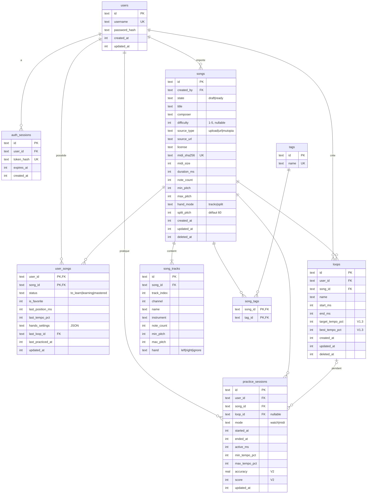

# Open Keys — Schéma de base de données

SQLite avec Drizzle ORM. Chaque table est définie dans le `*.schema.ts` de la feature qui la possède, puis ré-exportée par `apps/server/src/db/schema.ts`.

## 1. Conventions

- **Identifiants** : `text`, au format **ULID**. Ils peuvent être générés côté client, ce qui permet de créer des données hors-ligne et de rendre les `PUT` idempotents.
- **Dates** : `integer` en millisecondes epoch UTC (`created_at`, `updated_at`, `deleted_at`).
- **Suppression logique** (`deleted_at`) sur les données synchronisées et sur les morceaux.
- **Temps musicaux** : en **ms de temps de partition** (à 100 % de vitesse), suffixe `_ms`.
- **Vitesse** : entier en pourcentage, de 25 à 100, suffixe `_pct`.
- **Énumérations** : `text` avec une contrainte `CHECK`, et le type TypeScript dérivé dans `packages/contracts`.
- **Tables de données utilisateur** : une colonne `user_id` est obligatoire (préparation au multi-utilisateur, D3).
- **Pragmas** : `journal_mode=WAL`, `foreign_keys=ON`, `busy_timeout=5000`.

## 2. Diagramme

## 3. Détail des tables

### `users` — feature `auth`
Comptes. Un seul dans le MVP, créé par le seed à partir des variables d'environnement.

### `auth_sessions` — feature `auth`
| Colonne | Note |
|---|---|
| `token_hash` | SHA-256 du jeton contenu dans le cookie. Le jeton en clair n'est jamais stocké |
| `expires_at` | Expiration glissante de 90 jours |

Index : `(user_id)`, `(expires_at)` pour la purge.

### `songs` — feature `songs`
Catalogue **commun** (D3 : un `created_by` permet un futur catalogue par utilisateur).

| Colonne | Note |
|---|---|
| `state` | `draft` à l'import, `ready` après validation. Les brouillons de plus de 24 h sont purgés |
| `midi_sha256` | Unique : sert à dédoublonner les imports et donne le nom du fichier `/data/midi/<sha256>.mid` |
| `duration_ms`, `note_count`, `min_pitch`, `max_pitch` | Calculés à l'import (`analyzeMidi`) : affichage dans le catalogue, et zoom automatique en V1.1 |
| `hand_mode` | `tracks` : assignation par piste (`song_tracks.hand`). `split` : découpage par hauteur, `split_pitch` |
| `split_pitch` | Note MIDI de séparation. Les notes ≥ `split_pitch` vont à droite. Utilisé seulement si `hand_mode = split` |
| `license` | Texte libre (`Public Domain`, `CC-BY-SA 4.0`, `inconnue`…) |

Index : `(state, deleted_at)`, `(title)`, `(composer)`.
Recherche texte : `LIKE` suffit dans le MVP. Table virtuelle FTS5 si le besoin apparaît.

### `song_tracks` — feature `songs`
Une ligne par piste MIDI contenant des notes, avec son assignation à une main. Si une piste mélange plusieurs canaux, on crée une ligne par couple (piste, canal).
Contrainte d'unicité : `(song_id, track_index, channel)`.

### `tags`, `song_tags` — feature `tags`
Tags libres, en minuscules et nettoyés (`trim`). La table de liaison a une clé primaire composite et des suppressions en cascade.

### `user_songs` — feature `library`
Relation entre un utilisateur et un morceau : statut, favori et **réglages du lecteur** (UC-12).

| Colonne | Note |
|---|---|
| `hands_settings` | JSON validé par zod : `{ left: { audible, visible }, right: { audible, visible } }` |
| `last_loop_id` | Dernière boucle active, nullable, `ON DELETE SET NULL` |
| `updated_at` | Arbitre la règle « la dernière écriture l'emporte » |

La ligne est créée à la première interaction (upsert).

### `loops` — feature `practice`
Boucles A-B nommées. Contrainte `CHECK (end_ms > start_ms)`.
Index : `(user_id, song_id, deleted_at)`.

### `practice_sessions` — feature `practice`
Une ligne par session de lecture d'au moins 10 s effectives.

| Colonne | Note |
|---|---|
| `active_ms` | Temps de lecture effective (pauses exclues) |
| `min_tempo_pct` / `max_tempo_pct` | Plage de vitesses utilisée pendant la session |
| `mode` | `watch` (MVP) ; `midi` (V2) |
| `accuracy`, `score` | Remplis en V2 seulement (D10 : enrichissement, pas remplacement) |

Index : `(user_id, song_id, started_at)`, `(user_id, started_at)` pour le tableau de bord.

## 4. Règles de synchronisation

| Donnée | Écriture hors-ligne | Résolution des conflits |
|---|---|---|
| `songs`, `song_tracks`, `tags` | ❌ en ligne uniquement | — |
| `user_songs` | ✅ | `updated_at` le plus récent l'emporte (le serveur ignore un `PUT` plus ancien) |
| `loops` | ✅ | idem, suppression logique propagée |
| `practice_sessions` | ✅ | ajout seul. `PUT` idempotent sur l'identifiant ULID |

## 5. Stockage local (IndexedDB, Dexie)

| Store | Clé | Contenu |
|---|---|---|
| `songs` | `id` | Copie des métadonnées des morceaux (pour la liste hors-ligne) |
| `midiFiles` | `sha256` | `ArrayBuffer` du MIDI |
| `library` | `songId` | Copie de `user_songs` |
| `loops` | `id` | Copie des boucles |
| `outbox` | `id` (ULID) | `{ method, url, body, createdAt, attempts, lastError }` |

Les échantillons de piano et le shell de l'app sont gérés par le cache du Service Worker, pas par IndexedDB.

## 6. Évolutions prévues

| Version | Changement |
|---|---|
| V1.1 | Table `mutopia_pieces` (`mutopia_id` UK, `title`, `composer`, `opus`, `instrument`, `license`, `midi_url`, `synced_at`) + FTS5 |
| V1.3 | Utilisation de `loops.target_tempo_pct` / `best_tempo_pct` (colonnes déjà présentes) |
| V2 | Remplissage de `practice_sessions.accuracy` / `score`. Éventuellement une table `session_events` pour l'analyse détaillée des erreurs |
| Multi-utilisateur | Rien à migrer pour les données personnelles. Seule décision à prendre : catalogue commun ou `songs.owner_id` |
