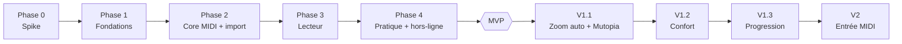

# Open Keys — Roadmap

Le développement est fait par IA, avec des revues attentives. Chaque tâche ci-dessous est pensée pour tenir dans **une PR relisable** : un seul objectif, des tests inclus, une CI verte. Une étape n'est terminée que si **tous** ses critères de fin sont remplis.

---

## Phase 0 — Spike technique (prototype jetable)

**Objectif** : valider la PWA (D7) sur la cible réelle avant d'écrire la vraie app.

- [ ] Page Vite unique : charger un MIDI dense (par exemple une étude de Chopin du domaine public, depuis Mutopia).
- [ ] Rendu PixiJS des notes qui tombent et du clavier de 88 touches.
- [ ] Son avec Tone.Sampler (Salamander allégé) et sustain.
- [ ] Vitesse à 50 % et boucle, pour vérifier que la synchro tient.
- [ ] Mesure FPS / temps par image, affichée à l'écran.

**Critères de fin** (Pixel 10, Firefox Android, puis Firefox Ubuntu/Windows)
- [ ] ≥ 55 fps en continu sur le morceau dense.
- [ ] Aucun décalage perceptible entre le son et l'image (test : métronome MIDI, notes très courtes).
- [ ] Démarrage de la lecture < 2 s avec les échantillons en cache.
- [ ] Décision consignée : **GO PWA** / **NO-GO → Flutter** (le backend n'est pas concerné).

---

## Phase 1 — Fondations

- [ ] **1.1** Monorepo pnpm : `apps/web`, `apps/server`, `packages/{core,contracts,config}`, TypeScript strict, Biome, Vitest.
- [ ] **1.2** CI GitHub Actions : lint, vérification des types, tests, build.
- [ ] **1.3** Serveur Hono : configuration validée par zod, `/api/health`, erreurs typées, logs.
- [ ] **1.4** Drizzle + SQLite : client, pragmas, migrations au démarrage, tables `users` et `auth_sessions`, seed de l'utilisateur.
- [ ] **1.5** Authentification : login, logout, me, middleware, rate-limit, tests.
- [ ] **1.6** Web : Vite, Tailwind, TanStack Router et Query, client `hc` typé, page de connexion, thème sombre.
- [ ] **1.7** Dockerfile multi-stage + `docker-compose.yml`. Déploiement Dokploy en HTTPS avec un volume `/data`.
- [ ] **1.8** README initial (présentation, stack, lancement en local) + LICENSE MIT.

**Critères de fin**
- [ ] Connexion fonctionnelle sur l'URL de production, depuis le Pixel 10 et un PC.
- [ ] Un push sur `main` → CI verte → redéploiement Dokploy.

---

## Phase 2 — Core MIDI et catalogue

- [ ] **2.1** `core/midi` : `parseMidi`, `analyzeMidi`, avec un jeu de MIDI de test (une piste, deux pistes, multi-canal, changements de tempo, sustain).
- [ ] **2.2** `core/hands` : `suggestHandMapping` et `applyHandMapping` (modes `tracks` et `split`), avec une couverture de tests élevée.
- [ ] **2.3** `core/timeline` : index trié et recherche par fenêtre de temps (dichotomie).
- [ ] **2.4** Tables `songs`, `song_tracks`, `tags`, `song_tags` + stockage des fichiers par hash.
- [ ] **2.5** `POST /imports` : upload et URL (protection SSRF, limites), dédoublonnage, brouillon.
- [ ] **2.6** `POST /imports/:id/confirm`, `PATCH /songs/:id`, `DELETE /songs/:id`, purge des brouillons et des fichiers orphelins.
- [ ] **2.7** `GET /songs` (filtres, tri), `GET /songs/:id`, `GET /songs/:id/midi` (ETag), `GET /tags`.
- [ ] **2.8** Web : page d'import (fichier/URL) et écran de vérification (tableau des pistes, découpage par hauteur, formulaire de métadonnées). Aperçu audio simple, sans le lecteur complet.
- [ ] **2.9** Web : catalogue (liste, recherche, filtres) et fiche d'un morceau.

**Critères de fin**
- [ ] Import de 5 MIDI variés (dont un à une seule piste) avec une assignation des mains correcte ou corrigeable.
- [ ] Un doublon est détecté. Une URL vers une IP privée est refusée.

---

## Phase 3 — Lecteur

- [ ] **3.1** `player/engine` : `clock`, `transport` (lecture, pause, seek, vitesse, boucle), `scheduler`, en reprenant les enseignements du spike.
- [ ] **3.2** `player/audio` : sampler Salamander (deux vélocités), sustain, son par main.
- [ ] **3.3** `player/renderer` : notes qui tombent, clavier, couleurs des mains, touches allumées, repères sur les C (C4 mis en évidence), objets réutilisés.
- [ ] **3.4** `player.store` + `ControlsOverlay` : lecture/pause, barre de progression, vitesse 25–100 %, mains (son et affichage), boucle A-B. Contrôles masqués au bout de 3 s.
- [ ] **3.5** Plein écran, paysage, Wake Lock, raccourcis clavier.
- [ ] **3.6** Tests : `clock`/`transport` (unitaires), e2e Playwright de lecture (Firefox et Chromium).

**Critères de fin**
- [ ] Critères de performance du spike tenus sur le Pixel 10 dans la vraie app.
- [ ] Une boucle à 50 % tourne 10 fois sans dérive de synchro.
- [ ] Checklist manuelle ergonomie (téléphone sur trépied) validée.

---

## Phase 4 — Pratique et hors-ligne → **MVP**

- [ ] **4.1** Tables `user_songs`, `loops`, `practice_sessions` + routes `PUT` idempotentes (la dernière écriture l'emporte).
- [ ] **4.2** Web : statut et favori (catalogue et fiche), reprise de la lecture (UC-12).
- [ ] **4.3** Boucles : sauvegarde, nommage, liste, rappel, suppression.
- [ ] **4.4** `session-tracker` : temps de lecture effective, enregistrement à partir de 10 s, statistiques sur la fiche du morceau.
- [ ] **4.5** PWA : manifeste, icônes, Service Worker (shell + échantillons), installation sur Android.
- [ ] **4.6** Dexie : cache des MIDI (morceaux ouverts + favoris), catalogue hors-ligne avec badge.
- [ ] **4.7** Outbox : file d'attente, rejeu (événement online, démarrage, toutes les 60 s), indicateur de synchronisation en attente.
- [ ] **4.8** E2E : mode avion → lecture d'un favori → création d'une boucle → retour du réseau → boucle visible sur un autre appareil.
- [ ] **4.9** README portfolio : captures d'écran, GIF, schéma d'architecture, choix techniques.

**Critères de fin du MVP**
- [ ] Apprendre un morceau de bout en bout uniquement avec l'app, sur le téléphone.
- [ ] Hors-ligne vérifié en mode avion sur le Pixel 10.
- [ ] Données cohérentes entre le Pixel 10, Windows et Ubuntu.

---

## V1.1 — Zoom automatique et Mutopia

- [ ] **Zoom automatique du clavier** : cadrage sur la plage `min_pitch`–`max_pitch`, avec une marge. Option : suivi glissant de la section en cours (fenêtre de N secondes), avec transitions douces.
- [ ] **Mutopia** : synchronisation de l'index (dépôt GitHub ou RSS) dans `mutopia_pieces`, tâche planifiée, recherche FTS5, import en un clic qui passe par l'écran de vérification. Licence renseignée automatiquement.

## V1.2 — Confort

- [ ] Décompte avant le départ (et au retour en début de boucle).
- [ ] Nom des notes en notation anglaise, sur les notes et/ou les touches.
- [ ] Métronome (synchronisé sur le Transport, temps fort accentué).
- [ ] Volume par main.

## V1.3 — Progression

- [ ] Vitesse cible et meilleure vitesse par boucle, montée en vitesse proposée (+5 %).
- [ ] Tableau de bord : temps de pratique par jour et par semaine, morceaux en cours, historique.

## V2 — Entrée MIDI

**Prérequis** : interface USB-MIDI (DIN 5 broches) + adaptateur USB-OTG.

- [ ] **Décision au démarrage** : Capacitor + plugin MIDI natif Android (recommandé, puisque Firefox n'a pas Web MIDI) ou Chrome dédié.
- [ ] `InputSource` : `WebMidiInput` (PC), `NativeMidiInput` (Capacitor), `ScreenKeyboardInput` (tests).
- [ ] Vérification des notes : fenêtre de tolérance ±100 ms, retour visuel (juste / manquée / en trop).
- [ ] Mode attente (avec gestion des accords).
- [ ] Score et précision dans `practice_sessions`.
- [ ] Pause avec une touche dédiée du piano (par exemple A0).

## Plus tard (non planifié)

- Gamification (séries de jours, objectifs quotidiens).
- Multi-utilisateur (le modèle de données est prêt).
- Détection au micro (non prioritaire).
