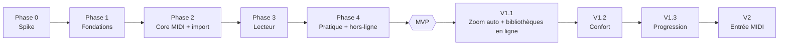

# Open Keys — Roadmap

Le développement est fait par IA, avec des revues attentives. **Une PR livre une fonctionnalité utilisable**, en regroupant plusieurs tâches et en les découpant en commits propres. Les tâches ci-dessous servent de liste de contrôle. Une étape n'est terminée que si **tous** ses critères de fin sont remplis.

---

## Phase 0 — Spike technique (prototype jetable)

**Objectif** : valider la PWA (D7) sur la cible réelle avant d'écrire la vraie app.

> **Ordre** : réalisé **après les tâches 1.1 et 1.2**, pour profiter de l'outillage (TypeScript strict, Biome, Vitest). Le code vit dans une branche `spike/falling-notes`, jamais mergée. Seuls les enseignements sont reportés dans la doc (décision GO/NO-GO, ajustements dans `03-architecture/04-lecteur.md`).

- [x] Page Vite unique : charger un MIDI dense (Étude op. 10 n°1 de Chopin, domaine public, Mutopia).
- [x] Rendu PixiJS des notes qui tombent et du clavier de 88 touches.
- [x] Son avec un sampler Salamander et sustain. Finalement en **Web Audio natif** : Tone.js est abandonné.
- [x] Vitesse à 50 % et boucle, pour vérifier que la synchro tient.
- [x] Mesure FPS / temps par image, affichée à l'écran.

**Critères de fin**
- [x] ≥ 55 fps en continu sur le morceau dense : **60–61 FPS** sur Chrome (PC et Pixel 10), limités par la fréquence de l'écran ; Firefox fluide (58–61 FPS mesurés en headless). Environ 0,1 ms de rendu par image.
- [x] Aucun décalage perceptible entre le son et l'image : validé à l'écoute sur Chrome et Firefox.
- [x] Démarrage de la lecture < 2 s avec les échantillons en cache : validé sur le Pixel 10 avec l'app déployée (échantillons servis localement, mis en cache par le Service Worker).
- [x] Décision consignée : **GO PWA** (D17, 2026-11-16).

**Enseignements reportés** : `03-architecture/04-lecteur.md` (horloge, sampler natif, pédale, scheduler, renderer).

---

## Phase 1 — Fondations

- [x] **1.1** Monorepo pnpm : `apps/web`, `apps/server`, `packages/{core,contracts,config}`, TypeScript strict, Biome, dependency-cruiser, lefthook, commitlint, Vitest.
- [x] **1.2** CI GitHub Actions : lint, vérification des types, règles d'architecture, tests, build.
- [x] **1.3** Serveur Hono : configuration validée par zod, `/api/health`, erreurs typées, logs.
- [x] **1.4** Drizzle + SQLite : client, pragmas, migrations au démarrage, tables `users` et `auth_sessions`, seed de l'utilisateur. Génération de `docs/database.dbml` à partir de Drizzle (script + vérification en CI).
- [x] **1.5** Authentification : login, logout, me, middleware, rate-limit, tests.
- [x] **1.6** Web : Vite, Tailwind, TanStack Router et Query, client `fetch` typé par les contrats (D20), page de connexion, thème sombre.
- [x] **1.7** `web.Dockerfile` (nginx) + `api.Dockerfile` (Node) + `docker-compose.yml`. Application compose dans Dokploy : routage `/api` → api, `/` → web, HTTPS, volume `data`.
- [x] **1.8** README initial (présentation, stack, lancement en local) + LICENSE MIT.

**Critères de fin**
- [x] Connexion fonctionnelle sur l'URL de production, depuis le Pixel 10 et un PC.
- [x] Un push sur `main` → redéploiement par Dokploy.

---

## Phase 2 — Core MIDI et catalogue

- [x] **2.1** `core/midi` : `parseMidi`, `analyzeMidi`, avec un jeu de MIDI de test (une piste, deux pistes, multi-canal, changements de tempo, sustain). *Fait : `analyzeMidi` (serveur). Le parsing des notes pour le lecteur (`parseMidi`) arrive avec la phase 3.*
- [x] **2.2** `core/hands` : `suggestHandMapping` et `applyHandMapping` (modes `tracks` et `split`), avec une couverture de tests élevée. *Fait : `suggestHandMapping` + `handForNote`.*
- [x] **2.3** `core/timeline` : index trié et recherche par fenêtre de temps (dichotomie).
- [x] **2.4** Tables `songs`, `song_tracks`, `tags`, `song_tags` + stockage des fichiers par hash.
- [x] **2.5** `POST /imports` : upload et URL (protection SSRF, limites), dédoublonnage, brouillon.
- [x] **2.6** `POST /imports/:id/confirm`, `PATCH /songs/:id`, `DELETE /songs/:id`, purge des brouillons et des fichiers orphelins.
- [x] **2.7** `GET /songs` (filtres, tri), `GET /songs/:id`, `GET /songs/:id/midi` (ETag), `GET /tags`.
- [x] **2.7b** Couvertures : `safe-fetch` mutualisé, `image-processor` (sharp → WebP 720×720), fournisseurs MusicBrainz/CAA et Wikidata, routes `cover` / `cover-suggestions`, purge des images orphelines.
- [x] **2.8** Web : page d'import (fichier/URL) et écran de vérification (tableau des pistes, découpage par hauteur, formulaire de métadonnées). Aperçu audio simple, sans le lecteur complet. *L'aperçu audio et le piano roll arrivent avec le lecteur (phase 3).*
- [x] **2.9** Web : catalogue (grille de couvertures, recherche, filtres) et fiche d'un morceau. Choix de la couverture dans l'écran de vérification et sur la fiche. Couverture générée en repli.

**Critères de fin**
- [ ] Import de 5 MIDI variés (dont un à une seule piste) avec une assignation des mains correcte ou corrigeable.
- [ ] Un doublon est détecté. Une URL vers une IP privée est refusée.
- [ ] Une couverture pertinente est proposée pour un morceau pop (pochette) et pour un morceau classique (portrait du compositeur).

---

## Phase 3 — Lecteur

- [x] **3.1** `player/engine` : `clock` (ancre audio ↔ partition, `currentTime − outputLatency − baseLatency`), `transport` (lecture, pause, seek, vitesse, boucle), `scheduler` (anticipation de 150 ms), en reprenant le spike.
- [x] **3.2** `player/audio` : `PianoSampler` en Web Audio natif (repris du spike), échantillons Salamander servis localement (deux vélocités), sustain sur le son uniquement, son par main. *Fait avec une seule couche de vélocité (jeu d'échantillons Salamander allégé).*
- [x] **3.3** `player/renderer` : notes qui tombent, clavier, couleurs des mains, touches allumées, repères sur les C (C4 mis en évidence), objets réutilisés.
- [x] **3.4** `player.store` + `ControlsOverlay` : lecture/pause, barre de progression, vitesse 25–100 %, mains (son et affichage), boucle A-B. Contrôles masqués au bout de 3 s.
- [x] **3.5** Plein écran, paysage, Wake Lock, raccourcis clavier.
- [x] **3.6** Tests : `clock`/`transport` (unitaires), e2e Playwright de lecture (Firefox et Chromium). *Unitaires (horloge, scheduler, moteur, contrôleur, clavier), parcours sur l'app complète (runtime simulé) et e2e Playwright sur le build de production : lecture depuis la fiche, vitesse et boucle.*

**Critères de fin**
- [x] Critères de performance du spike tenus sur le Pixel 10 dans la vraie app.
- [x] Une boucle à 50 % tourne 10 fois sans dérive de synchro.
- [x] Checklist manuelle ergonomie (téléphone sur trépied) validée.

---

## Phase 4 — Pratique et hors-ligne → **MVP**

- [x] **4.1** Tables `user_songs`, `loops`, `practice_sessions` + routes `PUT` idempotentes (la dernière écriture l'emporte).
- [x] **4.2** Web : statut et favori (catalogue et fiche), reprise de la lecture (UC-12).
- [x] **4.3** Boucles : sauvegarde, nommage, liste, rappel, suppression.
- [x] **4.4** `session-tracker` : temps de lecture effective, enregistrement à partir de 10 s, statistiques sur la fiche du morceau. *Les sessions passent par l'outbox (4.7).*
- [x] **4.5** PWA : manifeste, icônes, Service Worker (shell + échantillons), installation sur Android. *Mise à jour proposée par une bannière, jamais imposée pendant la pratique. Installation à valider sur le Pixel 10 une fois déployé.*
- [x] **4.6** Dexie : cache des MIDI (morceaux ouverts + favoris), catalogue hors-ligne avec badge. *Les autres données (utilisateur, fiches, bibliothèque, boucles) viennent du cache de TanStack Query, sauvegardé dans IndexedDB (D23).*
- [x] **4.7** Outbox : file d'attente, rejeu (événement online, démarrage, toutes les 60 s), indicateur de synchronisation en attente. *Rejeu aussi dès que la sonde de `/api/health` retrouve l'API, et après chaque écriture.*
- [x] **4.8** E2E : mode avion → lecture d'un favori → création d'une boucle → retour du réseau → boucle visible sur un autre appareil. *Dans Chromium et Firefox, en CI.*
- [x] **4.9** README portfolio : captures d'écran, GIF, schéma d'architecture, choix techniques.

**Critères de fin du MVP**
- [x] Apprendre un morceau de bout en bout uniquement avec l'app, sur le téléphone.
- [x] Hors-ligne vérifié en mode avion sur le Pixel 10.
- [x] Données cohérentes entre le Pixel 10, Windows et Ubuntu.

---

## V1.1 — Zoom automatique et bibliothèques en ligne

- [x] **Zoom automatique du clavier** : cadrage sur la plage `min_pitch`–`max_pitch`, avec une marge. Option : suivi glissant de la section en cours (fenêtre de N secondes), avec transitions douces.
- [x] **Mutopia** : synchronisation de l'index (dépôt GitHub ou RSS) dans `mutopia_pieces`, tâche planifiée, recherche FTS5, import en un clic qui passe par l'écran de vérification. Licence renseignée automatiquement. *Devenu une recherche **multi-sources** (D24) : Mutopia (pages de liste, le RSS s'arrête en 2019), MAESTRO et xivmidi, dans `source_pieces` ; recherche sur une colonne normalisée au lieu de FTS5 ; écoute avant import ; crédit de chaque fichier.*
- [ ] **MuseScore** : source de plus par l'API officielle (clé à demander à api@musescore.com, compte Pro pour les téléchargements). Interrogée en direct plutôt qu'indexée.

## V1.2 — Confort

- [x] Décompte avant le départ (et au retour en début de boucle).
- [x] Nom des notes en notation anglaise, sur les notes et/ou les touches.
- [x] Métronome (programmé sur l'horloge audio comme les notes, temps fort accentué).
- [x] Volume par main.

## V1.3 — Progression

- [x] Vitesse cible et meilleure vitesse par boucle, montée en vitesse proposée (+5 %).
- [x] Tableau de bord : temps de pratique par jour et par semaine, morceaux en cours, historique.

## V1.4 — Accompagnement (MIDI à plusieurs instruments)

Aujourd'hui, chaque piste est attribuée à une main ou ignorée. Une piste ignorée n'est ni affichée ni entendue, et toutes les pistes jouées ont le son du piano.

- [ ] **Rôle `accompaniment`** pour une piste, en plus de gauche / droite / ignorer : entendue, mais pas affichée en notes qui tombent. Contrat `trackHandSchema` et contrainte de `song_tracks.hand` (migration).
- [ ] **Proposition revue à l'import** : les pistes de piano (programmes General MIDI 0 à 7) deviennent les mains, les autres instruments l'accompagnement, percussions comprises (aujourd'hui ignorées). Modifiable sur l'écran de vérification, comme les mains.
- [ ] **Lecteur** : panneau « Instruments » pour activer ou couper chaque piste d'accompagnement (même principe que le son par main). Réglage mémorisé par morceau dans `user_songs`.
- [ ] **Son des instruments** : échantillons General MIDI libres (FluidR3 GM, licence à confirmer au démarrage), chargés à la demande pour les seuls instruments du morceau et mis en cache par le Service Worker. Kit de batterie GM pour le canal 10. Un instrument sans échantillons est joué au piano.
- [ ] Volume de l'accompagnement (avec le volume par main de la V1.2).

## V2 — Entrée MIDI

**Prérequis** : interface USB-MIDI (DIN 5 broches) + adaptateur USB-OTG.

- [ ] **Décision au démarrage** : Capacitor + plugin MIDI natif Android (recommandé, puisque Firefox n'a pas Web MIDI) ou Chrome dédié.
- [ ] `InputSource` : `WebMidiInput` (PC), `NativeMidiInput` (Capacitor), `ScreenKeyboardInput` (tests).
- [ ] Vérification des notes : fenêtre de tolérance ±100 ms, retour visuel (juste / manquée / en trop).
- [ ] Mode attente (avec gestion des accords).
- [ ] Score et précision dans `practice_sessions`.
- [ ] Pause avec une touche dédiée du piano (par exemple A0).

## Plus tard (non planifié)

- **Répartition des mains par algorithme** : la répartition actuelle (par piste, ou par hauteur autour d'une note pivot) se trompe souvent. Il faut un vrai algorithme qui suit chaque main dans le temps (continuité, écart maximal d'une main, croisements), et au moins sur PC, la possibilité de corriger la main de chaque note dans l'éditeur.
- Gamification (séries de jours, objectifs quotidiens).
- Multi-utilisateur (le modèle de données est prêt).
- Détection au micro (non prioritaire).
