# Open Keys — Maquettes

Exports statiques des maquettes, en WebP à 2x. La source éditable est le canevas de design (lien privé, à demander à l'auteur).

## Mobile — portrait

| | | |
|---|---|---|
| 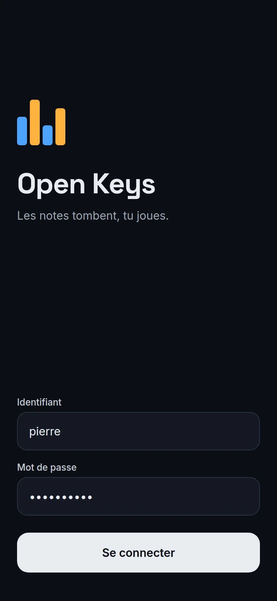 | 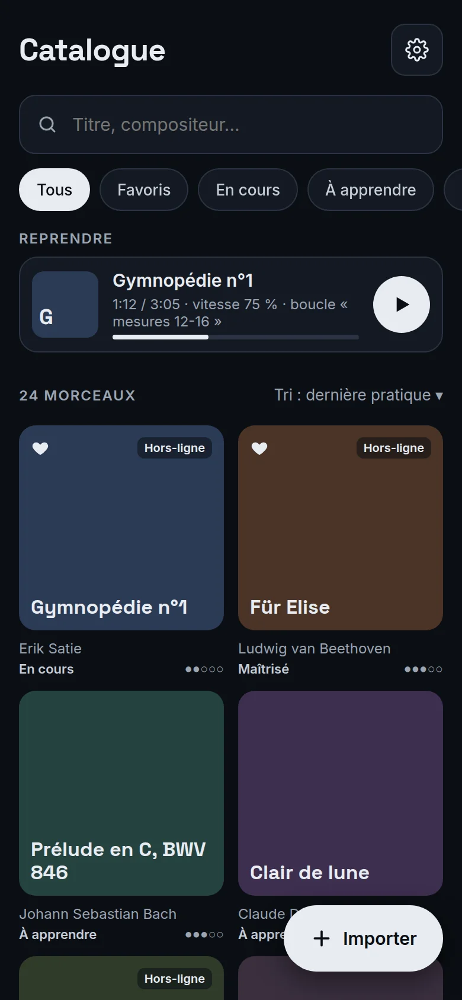 | 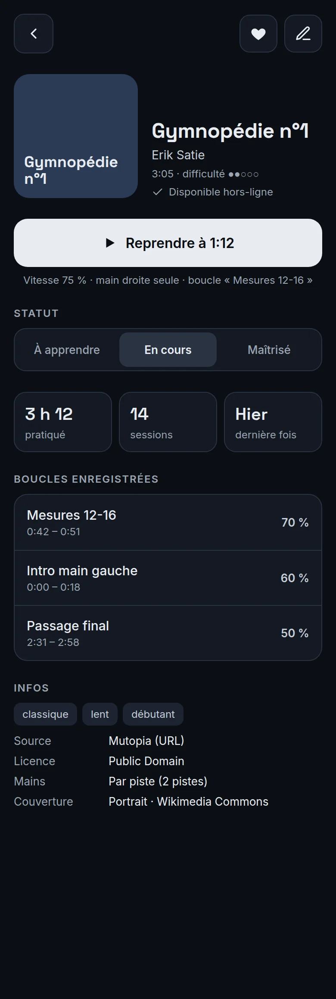 |
| Connexion | Catalogue | Fiche morceau |
| 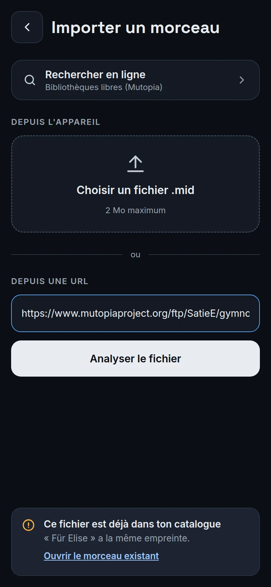 | 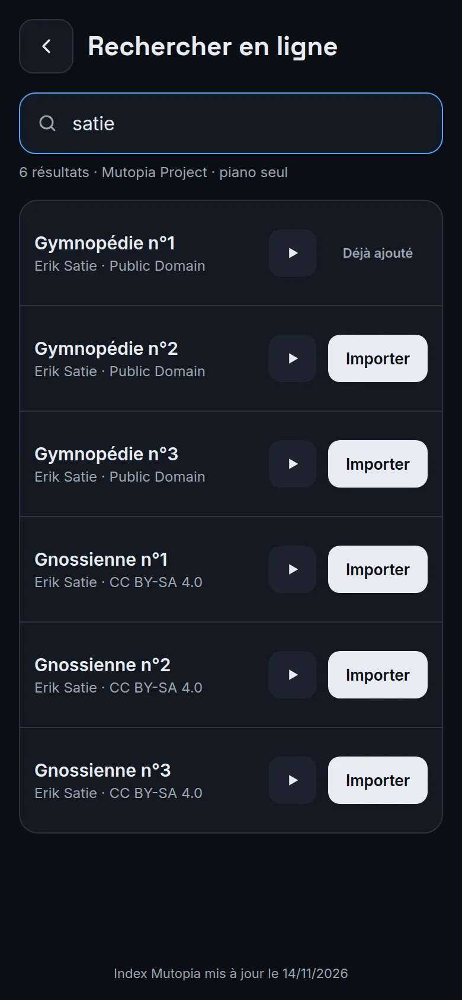 | 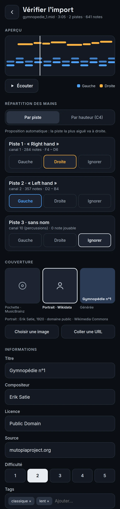 |
| Importer | Rechercher en ligne (V1.1) | Vérifier l'import |

## Mobile — paysage (lecteur)

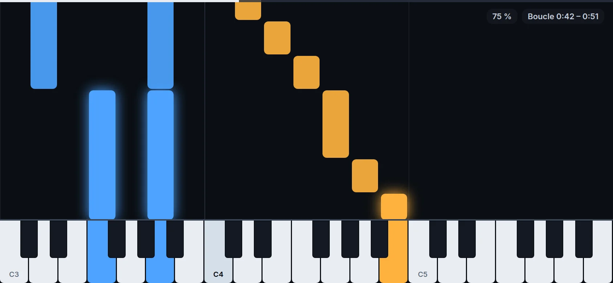
*Lecteur en cours de lecture (zoom automatique C3–B5, V1.1)*

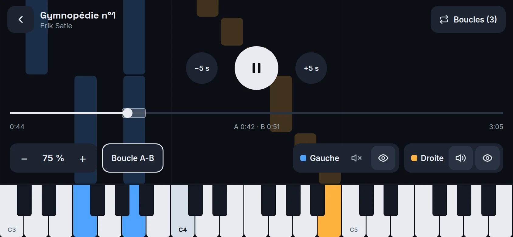
*Lecteur avec les contrôles affichés*

## PC

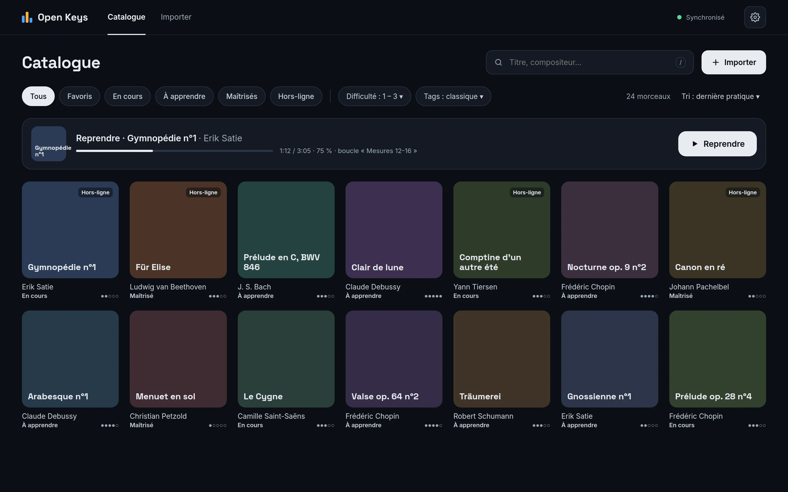
*Catalogue*

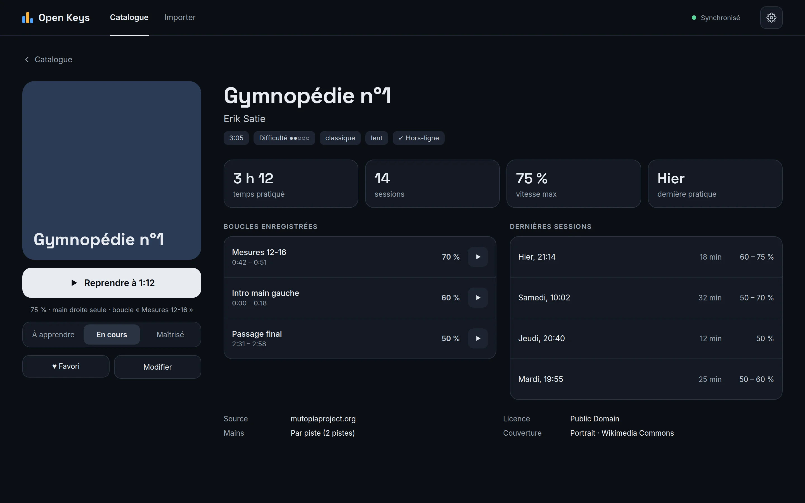
*Fiche morceau*

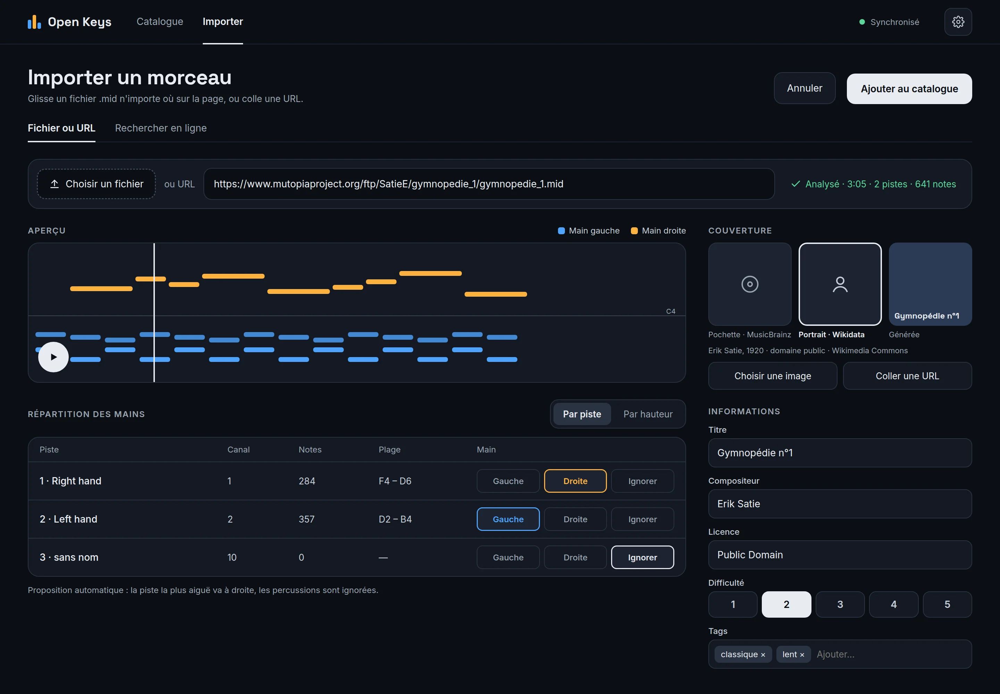
*Import par fichier ou URL, avec la vérification sur la même page*

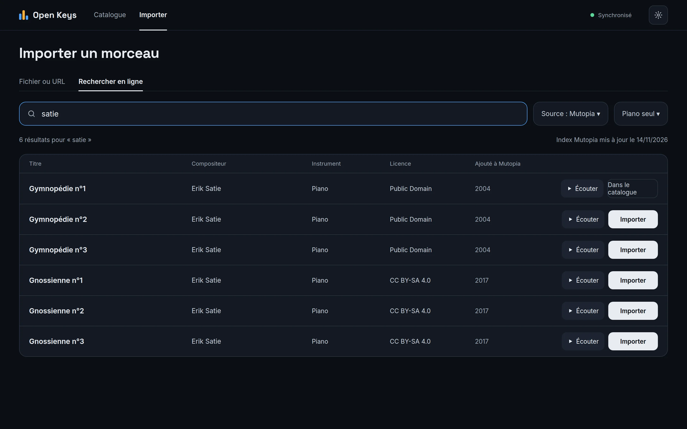
*Recherche en ligne (Mutopia, V1.1)*

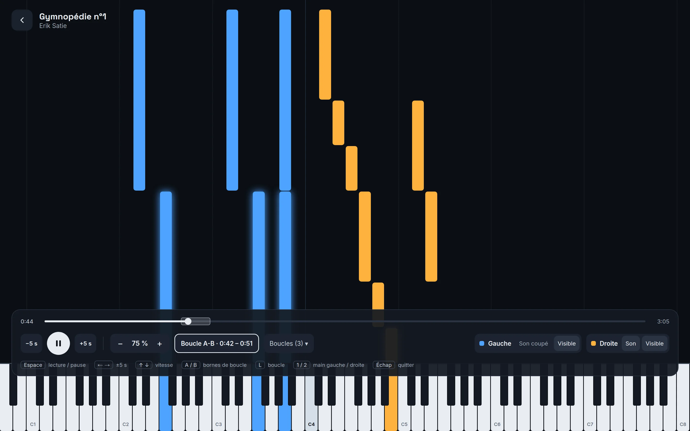
*Lecteur, clavier de 88 touches*

## Conventions visuelles

- Thème sombre ; l'interface est en niveaux de gris.
- **Main gauche en bleu `#4DA3FF`, main droite en orange `#FFB23F`** : ce sont les seules couleurs fortes. Elles sont distinguables aussi par les daltoniens.
- Typographies : Space Grotesk pour les titres, Inter pour le texte.
- Repère sur chaque C du clavier, C4 mis en évidence.
